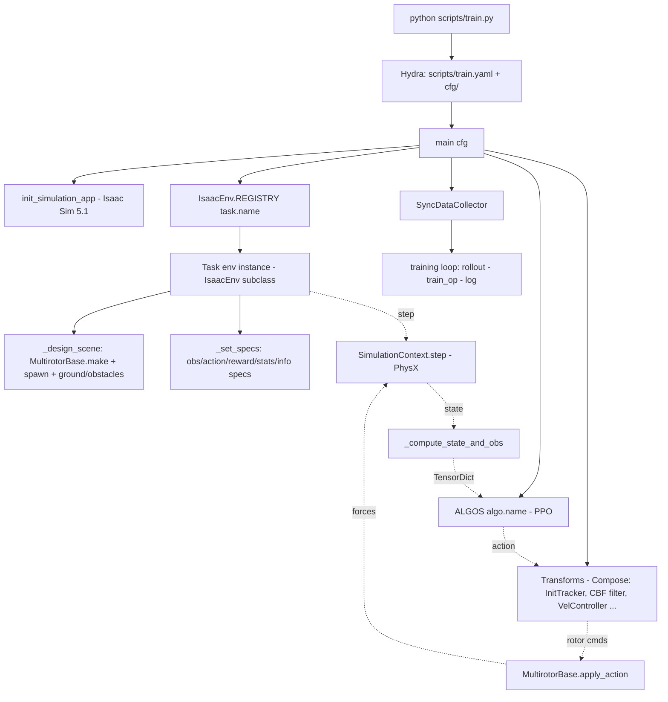
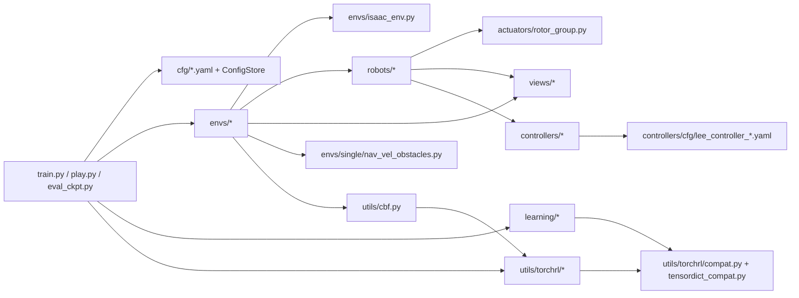

# OmniDrones Project Summary

> **用途**：供后续 Codex / AI Agent 进行功能开发、Bug 修复与重构的**工程地图**。
> **分析对象**：`drones/OmniDrones/`（git 仓库，当前分支 `feat/crazyflie-pidrate`，HEAD `1a62313`）。
> **基准环境**（本机实测）：Python=`/home/hybrid/miniconda3/envs/lz_env`，torch 2.7.0+cu128，
> torchrl 0.11.1，tensordict 0.11.0，Isaac Sim 5.1 + IsaacLab（本地 `drones/IsaacLab`，PyPI 包名 `isaaclab`），
> GPU = RTX 5090D（Blackwell SM120）。
> **生成日期**：2026-09-21（本文件由代码实读生成，未修改任何业务源码）。
> **注意**：本仓库同时存在旧文档 `drones/0908_project_summary.md`（任务级总结，仍然有效、未覆盖）。
> 本文件聚焦"代码结构 + 接口 + 调用链"，可回答"改哪里、影响谁"类问题。

---

## Development Quick Index（改哪里？先看这里）

| 需求 | 首先查看 | 然后查看 |
| --- | --- | --- |
| 修改 Crazyflie 参数（质量/惯量/桨） | `omni_drones/robots/assets/usd/crazyflie.yaml` | `omni_drones/controllers/cfg/lee_controller_crazyflie.yaml`（控制增益）、`omni_drones/robots/drone/crazyflie.py`（USD/参数路径） |
| 修改电机模型（一阶滞后/时间常数） | `omni_drones/robots/drone/multirotor.py::MultirotorBase._apply_rotors()` | `omni_drones/actuators/rotor_group.py::RotorGroup`（原版单机实现，仍在其它任务路径中使用）；yaml 键 `rotor_configuration.time_constant` |
| 修改 thrust / 力矩系数 | `crazyflie.yaml::rotor_configuration.force_constants / moment_constants / max_rotation_velocities` | `multirotor.py::initialize()`（KF=ω_max²·kF，KM 同理）、`lee_position_controller.py::compute_parameters()`（mixer 用的是同一批常数） |
| 修改 observation | 对应 Task 的 `_set_specs()` 与 `_compute_state_and_obs()`（如 `envs/single/nav_vel.py`） | `scripts/train.py`（`ravel_obs`、transforms）、`learning/ppo/ppo.py`（actor 输入 `("agents","observation")`） |
| 修改 action space | Task 的 `_set_specs()`（`action_spec`）+ `scripts/train.py::main`（`action_transform` 分支） | `utils/torchrl/transforms.py`（`VelController/PIDRateController/...` 的 `transform_input_spec` 会重写 `full_action_spec`） |
| 修改 reward | Task 的 `_compute_reward_and_done()` | 同函数里的 `self.stats[...]`（分项仪器）、`cfg/task/*.yaml`（权重）、`docs` 里的标定口径 |
| 修改 termination / done | Task 的 `_compute_reward_and_done()`（`terminated/truncated` 掩码）+ `isaac_env.py::IsaacEnv._reset / _step` | `soft_respawn`/`single_episode_per_window` 等开关；PPO 的 GAE 使用 `("next","terminated")` |
| 新增 Task | 复制 `envs/single/hover.py`（最简单） | 注册链：`envs/single/__init__.py` → `envs/__init__.py` → `IsaacEnv.REGISTRY`；新增 `cfg/task/Xxx.yaml` |
| 新增 Drone model | 复制 `robots/drone/hummingbird.py`（最简子类） | `robots/assets/usd/<name>.yaml` + USD；`robots/drone/__init__.py`；`MultirotorBase.REGISTRY`（`__init_subclass__` 自动注册） |
| 修改 PPO | `omni_drones/learning/ppo/ppo.py::PPOPolicy.train_op/_update` | `learning/ppo/common.py::GAE`、`learning/utils/valuenorm.py`、配置注册 `PPOConfig`（ConfigStore） |
| 修改 Controller | `omni_drones/controllers/lee_position_controller.py`（`LeePositionController`/`PIDRateController`） | `controllers/cfg/lee_controller_*.yaml`（增益）、`utils/torchrl/transforms.py`（控制器在动作链中的挂载点） |
| 修改 LiDAR / 传感器 | `omni_drones/envs/single/forest.py`（IsaacLab `RayCaster`） | `omni_drones/sensors/`（本 fork 仅有 camera/config）、`scripts/train_lidar.py`（自带 CNN 版 PPO） |
| 修改 simulator timestep | `cfg/base/sim_base.yaml`（`dt/substeps`）或 `cfg/task/*.yaml` 的 `sim:` 段 | `IsaacEnv.__init__`（`SimulationContext(physics_dt=...)`）、`IsaacEnv._step`（substeps 循环）、各 Task 的 `max_episode_length`（步数口径随之变化） |
| 调试 TensorDict | `IsaacEnv.__init__` 末尾 `pprint(self.fake_tensordict().shapes)` 的启动输出 | `utils/torchrl/env.py::AgentSpec`、`utils/torchrl/compat.py`（spec 类映射） |
| 调试 CBF / 安全滤波 | `omni_drones/utils/cbf.py`（`filter_velocity/cbf_violation/CBFVelocityFilter/build_cbf_filter`） | `scripts/train.py`（挂载顺序）、`envs/single/nav_vel.py`（reward core 与 `info.obstacle_cbf` 通道） |
| 升级 Isaac Sim / torchrl 前必读 | §27 Version Compatibility Layer | `utils/torchrl/compat.py`、`utils/tensordict_compat.py`、`views/__init__.py` |

---

## 1. Project Overview

OmniDrones 是清华 Botian Xu 等人开源的**多旋翼强化学习仿真平台**（论文 arXiv:2309.12825），
基于 NVIDIA Isaac Sim。本工作区中的 `drones/OmniDrones` 是它的一个**本地 fork**：

- 上游：`origin/main`（= commit `9ce7c20`，README 自述"基于 Isaac Sim 4.1.0"）。
- 本 fork 已完成两件大事：
  1. **Isaac Sim 5.1 + Blackwell 移植**（分支 `isaacsim-5.1-blackwell`，5 个 commit：
     `1f222d6` Port… → `a0b5163` transport force fix）；
  2. **NavVel 任务线**（当前分支 `feat/crazyflie-pidrate`）：Crazyflie Brushless 参数、
     速度指令动作层（SimpleFlight 风格 PID/rate/姿态控制器）、CBF 安全滤波、
     解析圆柱障碍世界、curriculum、批量实验脚本族。

**代码与 README 的差异（重要）**：

- README 描述：`The current version is developed based on Isaac Sim 4.1.0`。
- 实际代码：`omni_drones/__init__.py::init_simulation_app()` 从 **`isaacsim` 包**（5.1）的
  `apps/isaacsim.exp.base.python.kit` / `isaacsim.exp.base.kit` 选择 experience；
  多个文件内注释标注 `Isaac Sim 5.1` 兼容分支。**以源码为准：本 fork 运行在 Isaac Sim 5.1。**

---

## 2. Tech Stack

| 层 | 组件 | 证据 |
| --- | --- | --- |
| 仿真 | Isaac Sim 5.1（`isaacsim` 包）、`omni.isaac.core`（deprecated）、PhysX（torch backend） | `omni_drones/__init__.py`、`envs/isaac_env.py` |
| 场景/物理视图 | `omni_drones/views/__init__.py`（封装 `isaacsim.core.prims.*` 或 `omni.isaac.core.*`） | `views/__init__.py::ArticulationView/RigidPrimView` |
| 传感器（部分任务） | IsaacLab（`isaaclab.sensors.RayCaster/ContactSensor`） | `envs/single/forest.py`、`envs/single/pinball.py` |
| RL 框架 | TorchRL 0.11.1（`EnvBase`、`TransformedEnv`、`SyncDataCollector`、transforms） | `utils/torchrl/*`、`scripts/train.py` |
| 数据容器 | TensorDict 0.11（`TensorDict`/`CompositeSpec`→`Composite` 改名由 compat 层吸收） | `utils/torchrl/compat.py` |
| 配置 | Hydra 1.3 + OmegaConf（`@hydra.main`、ConfigStore 双来源） | `scripts/train.py`、`learning/ppo/ppo.py::PPOConfig` |
| 训练/日志 | wandb、tqdm、pandas、matplotlib | `utils/wandb.py`、`scripts/train.py` |
| 进程管理 | `setproctitle`（进程名改成 wandb run 名；**`pkill -f train.py` 抓不到**） | `scripts/train.py::main` |

---

## 3. Repository Structure

```text
drones/OmniDrones/
├── scripts/                  # 入口脚本（train/play/eval/demo/批量/诊断）
│   ├── train.py  train.yaml  # 训练主入口 + 根配置
│   ├── play.py               # 载入 ckpt 交互/回放
│   ├── eval_ckpt.py          # 确定性验收（fixed/train 起点、runtime filter ON/OFF）
│   ├── demo_fly.py record_fly.py vis_traj.py   # GUI 演示/录像/画轨迹
│   ├── train_batch.py np_chain_batch.py        # 多臂批量训练驱动
│   ├── np_acceptance_eval.py np_eval_report.py # 批量验收与报告
│   ├── train_lidar.py        # Forest+LiDAR 专用训练（自带 CNN PPO）
│   ├── wandb/ outputs/       # 运行产物（run 目录、hydra 输出）
│   └── experiments/          # 空/实验性
├── cfg/                      # Hydra 配置树（searchpath: file://../cfg）
│   ├── train 由 scripts/train.yaml 提供；cfg/ 下是各 group
│   ├── base/{env_base,sim_base}.yaml   # 被 task yaml 通过 defaults 合并
│   ├── task/*.yaml           # 任务配置（含 name 字段 = 类名查找键）
│   ├── task/profiles -> ../profiles    # 符号链接：task=profiles/xxx 可用
│   ├── profiles/*.yaml       # 冻结的完整 task 快照（实验用；无 defaults）
│   └── algo/*.yaml           # 各算法配置（ppo 例外，见 §8）
├── omni_drones/              # 框架核心
│   ├── __init__.py           # init_simulation_app + TensorDict.shapes/devices 补丁
│   ├── envs/                 # IsaacEnv + 各 Task（单机/多机/组合体）
│   ├── robots/               # RobotBase/MultirotorBase + drone 子类 + USD&yaml 资产
│   ├── actuators/rotor_group.py          # 旋翼模型（原版）
│   ├── controllers/          # Lee/PIDRate/Attitude/Rate + DSLPID（+cfg/ 增益）
│   ├── learning/             # PPO/MAPPO/HAPPO/SAC/TD3/MATD3/QMIX/DQN/TDMPC
│   ├── sensors/              # camera/config（本 fork 未用 LiDAR 于 NavVel）
│   ├── views/                # Isaac 5.1 兼容的 ArticulationView/RigidPrimView
│   └── utils/                # torchrl 集成、cbf、tensordict_compat、kit、wandb…
├── docs/                     # Sphinx 文档（上游遗留）
├── examples/                 # 独立示例（play/demo/controllers 测试）
├── scripts_paper/            # 论文复现实验（自带 train.py/experiments 配置）
└── README.md                 # 上游说明（注意其 Isaac 版本表述已过时）
```

**不要碰的区域**：`scripts/wandb/**`、`scripts/outputs/**`、`__pycache__`、`docs/`、`figures`。
这些是产物/文档，不影响运行（除非要复现历史指标）。

---

## 4. Important Files

| 文件 | 为什么重要 |
| --- | --- |
| `scripts/train.py` | 唯一训练入口；组装 env/transforms/policy/collector 与训练循环 |
| `scripts/train.yaml` | 根 Hydra 配置（searchpath、defaults、wandb、total_frames…） |
| `omni_drones/envs/isaac_env.py` | `IsaacEnv` 基类：SimulationContext、GridCloner 克隆、step/reset 生命周期、REGISTRY |
| `omni_drones/robots/drone/multirotor.py` | `MultirotorBase`：参数加载、rotor 组、`apply_action`、`get_state`、随机化 |
| `omni_drones/actuators/rotor_group.py` | 旋翼一阶动力学（原版 vmap 路径） |
| `omni_drones/utils/torchrl/transforms.py` | 动作/观测变换（控制器挂载、离散化、ravel） |
| `omni_drones/utils/torchrl/compat.py` | torchrl ≥0.6 spec 改名 shim（**全项目依赖**） |
| `omni_drones/utils/tensordict_compat.py` | `make_functional` shim（tensordict ≥0.11 删除） |
| `omni_drones/views/__init__.py` | Isaac 新旧 API 兼容 + 质量/惯量/COM 读写（fork 新增） |
| `omni_drones/learning/ppo/ppo.py` | PPO 实现 + `PPOConfig`（**ConfigStore 注册 algo=ppo**） |
| `omni_drones/utils/cbf.py` | CBF 滤波/违约/奖励核（fork 新增，NavVel 依赖） |
| `omni_drones/envs/single/nav_vel.py` | 本 fork 主任务（**改 reward/obs/termination 的第一现场**） |
| `omni_drones/envs/single/nav_vel_obstacles.py` | 障碍世界（几何解析 SDF、布局采样、obs 构建、CBF 几何） |
| `omni_drones/robots/assets/usd/crazyflie.yaml` | Crazyflie Brushless 全部动力学参数 |

---

## 5. Entry Points

所有入口都是 `@hydra.main(config_path=".", config_name="train")`（即都读 `scripts/train.yaml`），
差别只在 `main()` 里读哪些 key。

| 入口 | 作用 | 备注 |
| --- | --- | --- |
| `scripts/train.py::main` | 训练 | 训练循环、eval/save 间隔、wandb |
| `scripts/play.py::main` | 加载 ckpt 回放（GUI） | `config_path=FILE_PATH` 同上 |
| `scripts/eval_ckpt.py::main` | 确定性验收（MODE 探索类型） | `+checkpoint=`, `+rollout_steps=`, `+runtime_filter=`, `+set_seed=` 等 |
| `scripts/demo_fly.py` / `record_fly.py` / `vis_traj.py` | GUI 演示 / 录像 / 轨迹可视化 | NavVel 专用相机/轨迹参数 |
| `scripts/train_batch.py` / `np_chain_batch.py` | 批量训练驱动（多臂×多 seed×多难度） | 以子进程方式调用 `train.py`，cwd=`scripts/` |
| `scripts/np_acceptance_eval.py` + `np_eval_report.py` | 批量验收 + 报告 | 读 profile、跑 eval、汇总表格 |
| `scripts/train_lidar.py::main` | Forest+LiDAR 专用训练 | 自带 CNN PPOPolicy（与 learning/ 的 PPO 不同实现） |
| `examples/*.py` | 框架示例（多机、控制器测试、downwash） | 不参与主流程 |
| `scripts_paper/train.py` | 论文实验入口，独立配置目录 | 与主流程解耦 |

**启动顺序（任何入口都一样）**：

```text
python scripts/train.py task=<task|profile> algo=ppo [overrides...]
  ├─ Python import 阶段：import omni_drones.learning  → 注册 ALGOS 与 algo ConfigStore
  ├─ Hydra 组合 scripts/train.yaml + cfg/task/<x>.yaml + cfg/algo 或 ConfigStore
  ├─ main(cfg)：
  │    1. OmegaConf.resolve / set_struct(False)
  │    2. init_simulation_app(cfg)        # 启动 Isaac Sim（重！）
  │    3. init_wandb(cfg) + setproctitle
  │    4. env_class = IsaacEnv.REGISTRY[cfg.task.name]
  │    5. base_env = env_class(cfg, headless)
  │    6. transforms + TransformedEnv
  │    7. policy = ALGOS[cfg.algo.name.lower()](...)
  │    8. SyncDataCollector + 训练循环
```

---

## 6. Training Entry Flow（`scripts/train.py` 完整调用链）

```text
CLI: train.py task=profiles/NP-dual-p1-n16 algo=ppo headless=true ...      [np_chain_batch.py:77 实测命令]
 │
 ├─ @hydra.main(config_path=".", config_name="train")            scripts/train.py:35
 │    └─ scripts/train.yaml  (defaults: task:Hover, algo:ppo; hydra.searchpath=file://../cfg)
 │
 ├─ main(cfg)                                                    scripts/train.py::main
 │   ├─ init_simulation_app(cfg)                                 omni_drones/__init__.py
 │   ├─ init_wandb(cfg) -> run                                   omni_drones/utils/wandb.py
 │   ├─ env_class = IsaacEnv.REGISTRY[cfg.task.name]             envs/isaac_env.py（注册于 __init_subclass__）
 │   ├─ base_env = env_class(cfg, headless=cfg.headless)
 │   │     └─ IsaacEnv.__init__ -> … -> self._design_scene() -> self._set_specs()
 │   │           ├─ Task._design_scene(): MultirotorBase.make(name,controller) -> drone.spawn()
 │   │           ├─ IsaacEnv: GridCloner.clone() 复制到 N 个 env；filter_collisions；sim.reset()
 │   │           └─ Task._set_specs(): observation_spec / action_spec / reward_spec / stats / info
 │   ├─ transforms = [InitTracker()] (+ravel_obs / action_transform 分支)
 │   ├─ env = TransformedEnv(base_env, Compose(*transforms)).train(); env.set_seed(cfg.seed)
 │   ├─ policy = ALGOS[cfg.algo.name.lower()](cfg.algo, env.observation_spec, env.action_spec,
 │   │                                        env.reward_spec, device=base_env.device)
 │   ├─ [可选] +init_ckpt=<path> -> policy.load_state_dict(torch.load(...))
 │   ├─ frames_per_batch = env.num_envs * cfg.algo.train_every
 │   ├─ stats_keys = [k for k in observation_spec.keys(True,True) if k[0]=="stats"]
 │   ├─ episode_stats = EpisodeStats(stats_keys)
 │   ├─ collector = SyncDataCollector(env, policy=policy, frames_per_batch=…, total_frames=…,
 │   │                                device=cfg.sim.device, return_same_td=True)
 │   ├─ def evaluate():  env.rollout(max_steps=base_env.max_episode_length, policy=policy,
 │   │                   auto_reset=True, break_when_any_done=False) → 取首 episode 的 stats
 │   └─ for i, data in enumerate(tqdm(collector)):                # 训练循环
 │         ├─ episode_stats.add(data.to_tensordict())
 │         ├─ info.update(policy.train_op(data.to_tensordict()))  # PPO 更新
 │         ├─ eval_interval / save_interval 命中时 evaluate() / torch.save
 │         └─ run.log(info)
```

**每一步的输入/输出**：

| 步骤 | 输入 | 输出 | 配置来源 |
| --- | --- | --- | --- |
| `IsaacEnv.__init__` | `cfg`（整棵 Hydra 树）、`headless` | 已建场景 + specs 的 env | `cfg.task.*`、`cfg.sim.*`、`cfg.env.*` |
| `Task._design_scene` | — | 模板场景（`/World/envs/env_0/...`） | `cfg.task.drone_model/obstacle/...` |
| `Task._set_specs` | `self.drone.state_spec/action_spec` | `observation_spec/action_spec/reward_spec` | `cfg.task.time_encoding` 等 |
| `TransformedEnv` 包装 | transforms 列表 | 动作/观测变换链 | `cfg.task.action_transform`、`ravel_obs` |
| `ALGOS[...]` | spec 对象 + cfg.algo | policy（`TensorDictModuleBase`） | ConfigStore `PPOConfig` 或 `cfg/algo/*.yaml` |
| `SyncDataCollector` | env + policy | `frames_per_batch` 步的 rollout TensorDict | `cfg.algo.train_every`、`cfg.total_frames` |
| `policy.train_op` | rollout TD | 训练指标 dict | `cfg.algo.ppo_epochs/num_minibatches/entropy_coef` |

---

## 7. High-Level Architecture



关键设计点（读代码得出，不是猜测）：

1. **Env 是 TorchRL 的 `EnvBase`**（`IsaacEnv(EnvBase)`），batch_size=`[num_envs]`，所有张量默认在 `cfg.sim.device`（`cuda:0`）。
2. **多环境靠 USD 场景复制**（GridCloner 克隆 `env_0` 模板），不是 Python 循环。
3. **动作在"变换链"里被翻译**：策略输出 4 维速度指令 → `VelController` 调 `LeePositionController` → 变成 4 个 rotor 命令 → `apply_action` 变成力；环境本身只认 rotor 命令。
4. **观测/奖励/终止全部由 Task 的两个方法返回**（`_compute_state_and_obs`、`_compute_reward_and_done`），架构上没有独立的"reward manager"。
5. **缓动量的载体是 TensorDict 的 `info`/`stats` 子树**（如 `info.drone_state`、`info.prev_action`），变换（Transform）与环境通过它们握手。

---

## 8. Hydra Configuration System

### 8.1 三层来源

```text
① scripts/train.yaml（根配置，@hydra.main(config_name="train")）
     hydra.searchpath: [file://../cfg]      # 相对 scripts/ → 找到 cfg/
     sim: ${task.sim}    env: ${task.env}   # 引用 task 树内的字段
     total_frames / max_iters / eval_interval / save_interval / seed
     viewer / wandb
     defaults: [task: Hover, algo: ppo, _self_]

② cfg/task/<Name>.yaml（任务组）
     name: NavVel                 # ← 唯一被 Python 读取的"类名查找键"：IsaacEnv.REGISTRY[cfg.task.name]
     defaults: [/base/env_base@_here_, /base/sim_base@_here_]   # 把 env:/sim: 合并进本文件
     env: {num_envs, max_episode_length, env_spacing}
     drone_model: {name, controller}
     action_transform: velocity | PIDrate | discrete:N | null
     …（任务自己的参数，全部在 cfg.task.* 命名空间）

③ cfg/algo/<Name>.yaml（算法组）——**PPO 例外**：
     PPO 不存在 cfg/algo/ppo.yaml；它由 Python 注册：
     omni_drones/learning/ppo/ppo.py:  PPOConfig(dataclass) →
        cs.store("ppo", node=PPOConfig, group="algo")   # 还有 ppo_priv / ppo_priv_critic
     因为 train.py 在**模块导入期**就 `from omni_drones.learning import ALGOS`，
     ConfigStore 先于 Hydra 组合生效 → `algo=ppo` 解析成功。
```

**实测证据**（本机复现）：

```text
$ python -c "import hydra; hydra.initialize(config_path='scripts'); \
             hydra.compose('train', overrides=['algo=ppo'])"
→ MissingConfigException: Could not find 'algo/ppo'        （未导入 omni_drones.learning 时）

$ 先 import omni_drones.learning，再 compose
→ RESOLVED OK, algo = {'name':'ppo','train_every':32,'ppo_epochs':4,'num_minibatches':16,
                       'entropy_coef':0.001,'priv_actor':False,'priv_critic':False,
                       'checkpoint_path':None}            （与 PPOConfig 字段一一对应）
```

> ⚠️ **AI Agent 注意**：任何**不导入 `omni_drones.learning`** 却想 compose 完整配置的脚本
> （如独立的 hydra 检查工具）都会在 `algo=ppo` 上失败。这不是 bug，别去 `cfg/algo/` 里"补"一个 ppo.yaml
> ——那会同时改变默认值的来源。若确实需要静态 YAML，请与用户确认。

### 8.2 配置最终生效点（"哪一行代码"）

| 配置键 | 生效位置 |
| --- | --- |
| `cfg.task.name` | `scripts/train.py`：`env_class = IsaacEnv.REGISTRY[cfg.task.name]` |
| `cfg.headless` | `omni_drones/__init__.py::init_simulation_app`（选 .kit experience）+ `IsaacEnv.enable_render(not headless)` |
| `cfg.sim.*` | `IsaacEnv.__init__`：`SimulationContext(physics_dt=cfg.sim.dt, sim_params=…)`；`use_gpu_pipeline` 等直接进 PhysX |
| `cfg.sim.device` | `EnvBase(device=…)`；`ALGOS[...](device=…)`；`SyncDataCollector(device=…)` |
| `cfg.env.num_envs` | `EnvBase(batch_size=[num_envs])` + `GridCloner.generate_paths(..., num_envs)` |
| `cfg.env.max_episode_length` | `IsaacEnv.truncated = progress_buf > max_episode_length`（注意 `_reset` 里用 `>`，`_compute_reward_and_done` 里用 `>=`——语义以 reward/done 版本为准） |
| `cfg.task.action_transform` | `train.py/main` 的 if-elif 分支（velocity/PIDrate/discrete…） |
| `cfg.task.ravel_obs` | `train.py`：`ravel_composite(...)` 决定 encoder 是 MLP 还是实体编码器 |
| `cfg.algo.train_every` | `frames_per_batch = env.num_envs * int(cfg.algo.train_every)` |
| `cfg.algo.entropy_coef` | `PPOPolicy.entropy_coef`（2026-09 起可配；此前硬编码） |
| `cfg.total_frames` | `SyncDataCollector(total_frames=…)`（迭代结束条件） |
| `cfg.wandb.*` | `utils/wandb.py::init_wandb` |

### 8.3 profiles 目录

`cfg/profiles/*.yaml` 是**冻结的完整 task 快照**（无 defaults、自带全部键），
通过符号链接 `cfg/task/profiles -> ../profiles` 让 `task=profiles/<name>` 可解析。
批量脚本（`np_chain_batch.py`）全部用这种方式固定实验口径。修改 profile = 改变实验定义，
**历史 checkpoint 的可复现性依赖它**，不要随手改。

---

## 9. Environment Architecture（`IsaacEnv`）

定义：`omni_drones/envs/isaac_env.py::IsaacEnv(EnvBase)`（约 446 行）。

### 9.1 初始化顺序（`__init__`）

```text
super().__init__(device=cfg.sim.device, batch_size=[cfg.env.num_envs], run_type_checks=False)   # TorchRL EnvBase
enable_render(not headless)                    # 只影响 _should_render
num_envs / max_episode_length / substeps       # 常用参数缓存
[检查] stage_utils.get_current_stage() is not None   # 必须已 init_simulation_app
_configure_simulation_flags(sim_params)        # carb settings + enable_extension(viewport/rtx/replicator…)
self.sim = SimulationContext(stage_units_in_meters=1.0, physics_dt=cfg.sim.dt,
                             rendering_dt=cfg.sim.dt, backend="torch",
                             sim_params=sim_params, physics_prim_path="/physicsScene", device="cuda:0")
_create_viewport_render_product()              # 建立 /OmniverseKit_Persp 的 rgb annotator（enable_viewport=True 时）
cloner = GridCloner(spacing=cfg.env.env_spacing); cloner.define_base_env("/World/envs")
template = "/World/envs/env_0"
global_prim_paths = self._design_scene()       # ★ Task 侧建模板场景（spawn drone/地面/障碍）
envs_prim_paths = cloner.generate_paths("/World/envs/env", num_envs)
self.envs_positions = cloner.clone(source_prim_path=template, prim_paths=..., replicate_physics=cfg.sim.replicate_physics)
self.envs_positions = torch.tensor(...)        # (num_envs, 3)
central_env_idx = envs_positions.norm(dim=-1).argmin()   # 相机对准中间那个 env
RobotBase._envs_positions = envs_positions.unsqueeze(1)  # 全局：drone.get_world_poses(env_frame=True) 用
cloner.filter_collisions(...)                  # 不同 env 实例之间不碰
self.sim.reset()                               # ★ 物理视图此时才可 initialize
self.debug_draw = DebugDraw()
self._tensordict = TensorDict({"progress": zeros(num_envs)}, batch_size)
self.done_spec = CompositeSpec(done/terminated/truncated, DiscreteTensorSpec(2,(1,),bool)).expand(num_envs)
self._set_specs()                              # ★ Task 侧定义 obs/action/reward/stats/info specs
pprint(self.fake_tensordict().shapes)          # 启动日志打印 shape（排查 shape mismatch 的第一现场）
```

### 9.2 Step / Reset 生命周期

```text
EnvBase.step(td)  (由 torchrl 提供)
   └─ IsaacEnv._step(tensordict):
        for substep in range(self.substeps):          # 默认 substeps=1，NavVel 也用 1
            self._pre_sim_step(tensordict)            # ★ Task：读 action、apply_action
            self.sim.step(self._should_render(substep))  # ★ 物理推进（PhysX）
        self._post_sim_step(tensordict)               # Task 钩子（多数任务空实现）
        self.progress_buf += 1
        td = TensorDict({}, batch_size)
        td.update(self._compute_state_and_obs())      # ★ Task：状态→obs / info
        td.update(self._compute_reward_and_done())    # ★ Task：reward / terminated / truncated
        return td

IsaacEnv._reset(tensordict):
   env_mask = tensordict["_reset"] (或全 True) → env_ids = mask.nonzero()
   self._reset_idx(env_ids)                           # ★ Task：重置博士状态/目标/统计
   progress_buf[env_ids] = 0
   td = {} ; td.update(self._compute_state_and_obs())
   td["truncated"] = progress_buf > max_episode_length
```

### 9.3 抽象钩子（子类必须实现）

| 钩子 | 何时调用 | 必须做的事 |
| --- | --- | --- |
| `_design_scene()` | `__init__` 内、cloner 之前 | 创建 `env_0` 模板：drone.spawn、地面、target、障碍；返回跨环境共用的 prim 列表 |
| `_set_specs()` | `__init__` 内、scene 之后 | 定义 `observation_spec/action_spec/reward_spec`、`agent_spec[...]`、`stats`、`info` |
| `_reset_idx(env_ids)` | 每轮 reset | 重置 drone 状态/目标/统计（用 `env_ids` 索引，**必须支持部分重置**） |
| `_pre_sim_step(td)` | 每个 substep 前 | 读 `td[("agents","action")]` → `drone.apply_action()` |
| `_compute_state_and_obs()` | 每步 & reset 后 | 返回含 `agents/observation(+intrinsics)`、`info`、`stats` 的 TensorDict |
| `_compute_reward_and_done()` | 每步 | 返回 `agents/reward`、`done/terminated/truncated` |

### 9.4 其它要点

- **device**：`IsaacEnv` 不允许 `to(其它device)`（显式 raise）；所有 spec 一律 `.to(self.device)`。
- **vectorized**：`num_envs` 个独立场景（USD 复制 + 物理并行 + 张量批处理），**没有 Python for-loop**。
- **render**：`enable_render(bool|callable)` 控制 `sim.step(render)`；`render("rgb_array")` 走 `_rgb_annotator`（fork：兼容 5.x 的 buffer/shape/dtype 变化，输出 `(H,W,3) uint8`）。
- **close()** 是空实现（函数体第一行 `return # TODO: fix this`）——别依赖它清理。

---

## 10. Task Architecture（把任务写成 IsaacEnv 子类）

所有 Task 都是 `IsaacEnv` 子类 + 两个计算函数 + 一组 spec。以 `Hover`（最简单）为例：

```python
# omni_drones/envs/single/hover.py
class Hover(IsaacEnv):
    def __init__(self, cfg, headless):
        self.reward_effort_weight = cfg.task.reward_effort_weight   # 先读 cfg.task.*
        ...
        super().__init__(cfg, headless)          # ← 内部会调用 _design_scene / _set_specs
        self.drone.initialize()                  # 物理视图初始化（必须在 sim.reset() 之后）
        self.init_poses = self.drone.get_world_poses(clone=True)
    def _design_scene(self):     # 建 drone 模板 + target prim + 地面
    def _set_specs(self):        # observation_spec / action_spec / reward_spec / stats / info
    def _reset_idx(self, env_ids):  # 采样初始位姿、清 stats
    def _pre_sim_step(self, td):    # self.effort = self.drone.apply_action(td[("agents","action")])
    def _compute_state_and_obs(self):
    def _compute_reward_and_done(self):
```

**Task 通用模式（从 6+ 个任务归纳）**：

1. `obs = cat([rpos, drone_state[..., 3:], rheading, time_encoding?, (障碍块)?], dim=-1)`——**位置以外一切 + 相对量**，天然平移不变。
2. `stats` 是 `CompositeSpec(...).expand(num_envs)`，作为 `observation_spec["stats"]` 的一部分，被 `EpisodeStats` 在 done 步采样。
3. `info` 子树承载给 Transform 用的中间量（`drone_state` 13 维 root state、`prev_action`）。
4. reward 用 in-place EMA 写 stats（`lerp_(x, 1-alpha)`），return/episode_len 累加。
5. done = terminated | truncated；terminated 通常含 crash/NaN/OOB。

### 10.1 Hover（简单单机）

| 项 | 值（实测/读码） |
| --- | --- |
| obs | `rpos(3) + drone_state[3:](20) + rheading(3) + time(4)` = **30**（`obs_spec=(1,30)`） |
| action | `drone.action_spec` = `[-1,1]^4`（直接 rotor 命令） |
| reward | `r_pose + r_pose*(r_up + r_spin) + w_effort·exp(-effort) + w_smooth·exp(-throttle_diff)` |
| terminated | `z<0.2` 或 `‖(rpos,rheading)‖>4` 或 NaN |
| 参考价值 | ★★★★★ 新增任务的最佳模板（结构最小、无外部依赖） |

### 10.2 NavVel（fork 主任务，复杂单机）

| 项 | 值 |
| --- | --- |
| 场景 | 6×6×3 m 房间；地面 + 障碍（球堆或解析圆柱）；Crazyflie |
| action | 4 维速度指令 `[vx,vy,vz,yaw]`（world frame）+ `action_transform: velocity` |
| obs | 30 + 障碍块（球堆：`4K`；圆柱：`7K`）+ 可选 safety 通道（`obs_safety`），如 K=4 圆柱 → **58**；K=8 球堆 → 62 |
| reward | legacy = Hover 底座 + arrival + PBRS + 障碍项（log/碰撞边沿/近障减速）+ CBF 项；另有 navgoal/r1/f1 三种备选 scheme（见 `drones/new_reward.md`） |
| terminated | `crash(z<z_min 或 NaN)` / `oob(出房间或 z>z_max)` / `collide_exceed`；`soft_respawn` 决定"直接 terminated"还是"重生一条命" |
| 特殊统计 | `stats.arrival/collision/min_clearance/success_rate/term_*`（分项奖励仪器） |
| eval 专用 | `single_episode_per_window`（一局=一条命，锁存后不再上报 done，防止 eval 期间重开） |
| 参考价值 | ★★★★ 复杂任务范例（障碍、curriculum、CBF、eval 口径都在里面） |

### 10.3 Formation（多机）

见 §29 Multi-Agent。

---

## 11. Task Registry（`task=Hover` → 类）

```text
Hydra 组合
  cfg/task/Hover.yaml  ← 文件里唯一的 Python 语义键：name: Hover
        │
        ▼
scripts/train.py:  env_class = IsaacEnv.REGISTRY[cfg.task.name]     # 按字符串键查字典
        │
        ▼
注册侧（导入时副作用）：
  omni_drones/envs/isaac_env.py:  IsaacEnv.__init_subclass__ 自动把每个子类登记两次：
        REGISTRY[ClassName] = cls ;  REGISTRY[classname.lower()] = cls
  触发点：train.py 里 `from omni_drones.envs.isaac_env import IsaacEnv`
        → 导入包 omni_drones.envs → 执行 envs/__init__.py
        → `from .single import Hover, Track, FlyThrough, NavVel`（single/__init__.py 里还有 Forest/Pinball）
        → 依次 import 各 Task 模块 → 子类定义完毕 → REGISTRY 填满
        （envs/__init__.py 还导入 payload/inv_pendulum/dragon/platform/transport/formation/rearrange）
```

**要点 / 坑**：

- registry 键 = **类名或小写类名**；`cfg.task.name` 写错 → 立刻 `KeyError`（不是静默）。
- `IsaacEnv.__init_subclass__` 里若重复类名会 `raise ValueError`（防重复定义）。
- `cfg/task/profiles/` 是符号链接；`task=profiles/xxx` 与 `task=xxx` 都能写（前者用于实验快照）。
- `Forest`/`Pinball` 依赖 Isaac Lab（`envs/single/pinball.py` 模块级 `from isaaclab.sensors import ContactSensorCfg`），
  `envs/__init__.py` 用 try/except 包住它们的导入并打印提示。

---

## 12. Drone Architecture

```text
MultirotorBase.make(drone_model.name, drone_model.controller)     multirotor.py（类方法）
   ├─ drone_cls = MultirotorBase.REGISTRY[name]        ← 由 __init_subclass__ 注册（类名/小写）
   ├─ drone = drone_cls()                              ← 读 yaml 参数、建 intrinsics/state spec（不碰仿真）
   └─ controller_cls = ControllerBase.REGISTRY[controller]  → controller(gravity[1], drone.params).to(device)

Task._design_scene():
   drone.spawn(translations=[...])                    # prim_utils.create_prim(usd_path=…)，模板 env_0 下
   (返回 prim)
Task.__init__（super 之后）:
   drone.initialize()                                 # ArticulationView/RigidPrimView + base_link + rotors_view
   drone.setup_randomization(cfg['task']['randomization']['drone'])   # 可选 DR
```

**层级**：

```text
RobotBase (robots/robot.py, abc)                 # spawn/initialize/REGISTRY/资产路径
   └─ MultirotorBase (robots/drone/multirotor.py, 553 行)   # 参数、state、rotor、apply_action、随机化
        ├─ Crazyflie  (drone/crazyflie.py, 42 行)  # 仅 usd_path / param_path
        ├─ Hummingbird/Firefly/Iris/Neo11/OmAv    # 同上，各自 USD+yaml
        └─ Dragon (drone/dragon.py, 244 行)        # 组合体（多臂+底盘），覆写较多
```

**关键成员（`MultirotorBase.initialize` 之后）**：

| 成员 | Shape | 含义 |
| --- | --- | --- |
| `shape` | `(N, n)`（N=env 数，n=每 env 机数） | 全项目的批形状根基 |
| `_view` | ArticulationView，shape `(-1, n)` | articulation 句柄（dof 含 rotor joints） |
| `base_link` | RigidPrimView | 根刚体句柄（质量/惯量/位姿/速度） |
| `rotors_view` | RigidPrimView，shape `(*shape, num_rotors)` | 各旋翼刚体（用于取旋翼姿态→力矩轴、施加推力） |
| `rotor_joint_indices` | `(num_rotors,)` 或 None | dof 名以 `rotor` 开头的关节（可视化/物理转子转动） |
| `throttle/KF/KM/tau_up/tau_down/directions` | `(*shape, num_rotors)` | 逐 env 可随机化的旋翼参数 |
| `pos/rot/vel/vel_w/vel_b/heading/up` | `(*shape, 3/4/6)` | 状态缓存（`get_state()` 刷新） |
| `thrusts` | `(*shape, num_rotors, 3)` | 各旋翼推力（z 分量写值，其余为 0） |
| `torques/forces` | `(*shape, 3)` | 合力/合力矩（写回 PhysX 前） |
| `intrinsics` | CompositeSpec→TensorDict | 供 privileged actor/critic 的真实动力学参数（mass/inertia/KF/KM/…） |

**重要行为**：

- `update_sim: True`（crazyflie.yaml 有）→ `initialize()` 里把 yaml 的 **mass 和 inertia 写进仿真刚体**
  （`base_link.set_masses/set_inertias`）——这是 fork 的 CFB 改动，保证控制器用的 I 与物理一致。
- `_reset_idx(env_ids, train)`：清零 thrusts/torques/vel/acc → 随机化（train 用 train 分布，否则 eval 分布）
  → **把 throttle 初始化为悬停油门**：`throttle = sqrt(gravity / ΣKF)`（用 `rotors.f_inv`）。
- `get_state()`：`cat(pos(3), quat(4), vel_w(6), heading(3), up(3), throttle*2-1(num_rotors))`，
  共 **19+num_rotors** 维（Crazyflie=23）；`env_frame=True` 时 pos 减去 env 原点。
- 状态 spec：`MultirotorBase.state_spec = UnboundedContinuousTensorSpec(19+num_rotors)`。
- 动作 spec：`BoundedTensorSpec(-1, 1, num_rotors)`。
- 随机化接口 `setup_randomization(cfg)` 支持：`mass_scale / inertia_scale / t2w_scale / f2m_scale /
  drag_coef_scale / tau_up / tau_down / com`（train、eval 两套分布）。

**Drone 常量来源**：`param_path`（如 `robots/assets/usd/crazyflie.yaml`），字段：
`mass / inertia{xx,yy,zz} / l / drag_coef / update_sim / rotor_configuration{num_rotors, arm_lengths,
rotor_angles, directions, force_constants, moment_constants, max_rotation_velocities, time_constant, noise_scale}
/ LPF_coef / target_clip / min_thrust_ratio / max_thrust_ratio / fixed_yaw`。

## 13. Crazyflie（专项）

1. **类定义**：`omni_drones/robots/drone/crazyflie.py::Crazyflie`（42 行，仅 2 个类属性）：
   ```python
   class Crazyflie(MultirotorBase):
       usd_path:   str = ASSET_PATH + "/usd/cf2x_pybullet.usd"   # 注释说明 Isaac 自带资产有异常行为，故用 pybullet 版
       param_path: str = ASSET_PATH + "/usd/crazyflie.yaml"
   ```
2. **继承**：`Crazyflie → MultirotorBase → RobotBase`；与 Hummingbird/Firefly/Iris/Neo11/OmAv 完全共用逻辑。
3. **与 Hummingbird 等的差异**：**只有 USD 与 yaml 路径**；`omeva.py` 额外覆写少量几何。没有 Crazyflie 专属动力学代码。
4. **参数文件** `robots/assets/usd/crazyflie.yaml`（fork 已把参数换成 Crazyflie Brushless/CFB）：
   - `mass: 0.042`（CFB 实测 42 g；空心杯原 0.0321）
   - `inertia: {xx: 3.3e-5, yy: 3.6e-5, zz: 5.9e-5}`（kg·m²，论文带桨保护值）
   - `update_sim: True` → 初始化时把上述 mass/inertia **同步进 PhysX 刚体**
   - `rotor_configuration`: `num_rotors: 4`，`arm_lengths: 0.043×4`，`rotor_angles: [π/4, 3π/4, 5π/4, 7π/4]`，
     `directions: [-1, 1, -1, 1]`，`force_constants: 3.43639e-08 ×4`，`moment_constants: 1.058e-9 ×4`，
     `max_rotation_velocities: 2900 ×4 (rad/s)`，`time_constant: 0.05 (s)`，`noise_scale: 0.0`
   - `drag_coef: 0.0`，`LPF_coef: 1.0`（无低通），`target_clip: 1.0`，`min/max_thrust_ratio: 0.0/0.9`，`fixed_yaw: 0`
5. **rotor 数量**：`num_rotors = params["rotor_configuration"]["num_rotors"]`（`multirotor.py::__init__`）。
6. **rotor 位置/方向**：不在 Python 里硬编码——**位置来自 USD 里 `base_link/rotor_*` 刚体 prim**
   （`rotors_view` 按 `{prim_paths_expr}/rotor_*` 查找，`apply_action` 里用其世界姿态求力矩轴）；
   方向/力常数来自 yaml。**改桨布局 = 改 USD**（或旋翼 prim 命名），改桨性能 = 改 yaml。
7. **推力/力矩参数**：`KF = ω_max² · force_constants`（= 单电机满油门推力，N），
   `KM = ω_max² · moment_constants`（N·m/单位油门²）；计算在 `MultirotorBase.initialize()`。
8. **电机时间常数**：yaml 的 `time_constant: 0.05` → `use_motor_time_constant=True`；
   每步采用 `tau = dt / 0.05`（dt=0.01 → 0.2）做一阶滞后（见 §15）。
9. **action range**：`[-1, 1]^4`（`action_spec = BoundedTensorSpec(-1,1,num_rotors)`）。
10. **`apply_action()` 实际实现**：`MultirotorBase.apply_action`（Crazyflie **不覆写**）。
11. **controller 如何连接**：由 `cfg.task.drone_model.controller` 决定；NavVel 里 `controller: null`
    （低层控制被移到动作变换链：`train.py` 里构造 `LeePositionController` 挂到 `VelController`/`PIDRateController`）。
    旧的 `MultirotorBase.make` + `controller.compute()`（引擎内 RateController/AttitudeController 变换）仍支持其它任务。
12. **reset 时恢复的状态**（`MultirotorBase._reset_idx`）：thrusts=0、torques=0、vel/acc=0、
    （可选）随机化 mass/inertia/KF/KM/drag/tau、`throttle = sqrt(gravity/ΣKF)`（悬停油门）、throttle_difference=0。
    Task 侧再恢复位姿/速度/目标（如 `NavVel._reset_idx` → `drone.set_world_poses / set_velocities`）。
13. **batched 表示**：单个 drone 对象代表 N×n 个实例（N=env 数，NavVel 里 n=1），张量形状前缀 `(N, n)`；
    `shape = (N, n)` 由 `initialize()` 依据 `_view.count` 推断。
14. **控制器增益**：`omni_drones/controllers/cfg/lee_controller_crazyflie.yaml`（fork 新增，16 行）——
    `LeePositionController.__init__` 按 `uav_params['name']` 拼这个文件名去读；**换 yaml 名要同步建文件**。

---

## 14. MultirotorBase（专项）

### 14.1 构造阶段

| 阶段 | 代码 | 输入 → 输出 |
| --- | --- | --- |
| 读参数 | `__init__` 打开 `self.param_path` | yaml → `self.params`；`num_rotors` |
| 建 spec（未碰仿真） | `intrinsics_spec`（mass/inertia/com/KF/KM/tau_up/tau_down/drag_coef）、`state_spec`、`action_spec` | — |
| spawn | `RobotBase.spawn()` → `prim_utils.create_prim(usd_path=…)` | 模板 env_0 下的 prim |
| 物理视图 | `initialize()`：`ArticulationView(prim_paths_expr, shape=(-1, n))` + `base_link` + `rotors_view` | 可批量读写 |
| rotor 组 | `RotorGroup(params['rotor_configuration'], dt=self.dt)` → `make_functional` 提取参数 → `expand(shape)` | `throttle/KF/KM/tau_*/directions` |
| 质量同步 | `update_sim=True` 时 `set_masses/set_inertias`（fork） | 物理 = yaml |

### 14.2 状态与刷新

`get_state()`（**每步由 Task 调用**）刷新 `pos/rot/vel_w/vel_b/heading/up`，返回拼接状态（单位见 §31）。

### 14.3 Action → rotor → force 全链路（真实代码路径）

```text
action (…, num_rotors) ∈ [-1,1]                       # 由 Task 传入（已经过 Transform 翻译）
 └─ MultirotorBase.apply_action(actions):
      rotor_cmds = actions.expand(*self.shape, self.num_rotors)
      last_throttle = self.throttle.clone()
      thrusts, moments = self._apply_rotors(rotor_cmds)          # ← 一阶电机模型（无 vmap，逐元素张量运算）
      rotor_pos, rotor_rot = self.rotors_view.get_world_poses()
      torque_axis = quat_axis(rotor_rot, axis=2)                 # 旋翼 z 轴（世界系）
      self.thrusts[..., 2] = thrusts                             # 本体系推力（z）
      self.torques[:] = (moments.unsqueeze(-1) * torque_axis).sum(-2)
      self.forces.zero_()
      if self.n > 1:  # 多机同场：简化 downwash（downwash()，kz=0.3）
      self.forces[:] += (self.drag_coef * self.masses) * self.vel[..., :3]
      [Isaac 5.1] rotor_joint_indices 非空: self._view.set_joint_velocities(throttle*directions*MAX_ROT_VEL)
      [Isaac 5.1] is_articulation: 把 forces/torques 拼成 (count, num_bodies, 3) 一次性
            self._view._physics_view.apply_forces_and_torques_at_position(..., is_global=True)
                  ↑ body 0 = base_link 合力/矩；body 1..num_rotors = 各旋翼推力（世界系 quat_rotate 后）
      else: 非 articulation 分支（组合体内部）见 §14.4
      self.throttle_difference[:] = ||throttle - last_throttle||     # 供光滑性 reward
      return self.throttle.sum(-1)                                  # 返回 effort 标量（Hover 用它做 reward）
```

### 14.4 两个已知坑（fork 修复记录）

- **Isaac 5.1 力取消 bug**：对 articulation 中任一体施加力会清掉其它体的力 →
  fork 改为"合并到 articulation physics view 一次性施加"；非 articulation（如 transport 内部的无人机）走
  fallback：只对 `rotors_view` 施推力、**跳过 base_link 的 drag/torque**（commit `a0b5163`），
  否则两处分别施加会互相取消。**修改这段前务必读注释**。
- `self.jerk` 在 `get_linear_smoothness/get_angular_smoothness` 里被引用，但 `jerk` 从未被赋值
  （被注释掉了）——**未确认**：这两函数当前是否可用（调用点见 `learning` 侧？实测未见调用；勿依赖）。

---

## 15. Actuator / Rotor Dynamics

**两处实现，语义必须保持一致**：

1. `omni_drones/actuators/rotor_group.py::RotorGroup.forward(cmds)`（原版，vmap 用；`MultirotorBase._apply_rotors` 是它的逐元素克隆）。
2. `omni_drones/robots/drone/multirotor.py::MultirotorBase._apply_rotors(cmds)`（fork 的 vmap 替代品，**实际执行路径**）。

公式（源码逐行，两个实现相同）：

```python
target_throttle = sqrt(clamp((cmds + 1) / 2, 0, 1))        # 动作 [-1,1] → 目标油门（平方律反解）
tau = where(target_throttle > throttle, tau_up, tau_down)  # 上升/下降不同时间常数
tau = clamp(tau, 0, 1)
if use_time_constant:            # yaml 有 time_constant（Crazyflie=0.05 s）
    tau = dt / tau.clamp_min(1e-3)                        # 一阶滞后步长因子 = dt/τ
throttle += tau * (target_throttle - throttle)            # 一阶电机/桨动态（in-place）
t = clamp(throttle², 0, 1)                                # 油门→推力映射为平方律
thrusts = t * KF                                          # (…, num_rotors) 单位 N
moments = (t * KM) * (-directions)                        # (…, num_rotors) 反扭矩，N·m
```

**关键点**：

- 动作 → 目标油门是**平方律反解**：`throttle = sqrt((a+1)/2)`，而推力 `= throttle²·KF`，
  因此**推力对动作为线性**（`a=1` → 满推力 KF；`a=-1` → 0）。
- **没有显式 RPM 状态**（有 `MAX_ROT_VEL=2900 rad/s` 只用于把 throttle 映射成关节可视转速）。
- legacy 路径（无 `time_constant` 的旧 yaml）用 `tau=0.43`（**把它当"每步比例"而不是秒**，`clamp(0,1)`）。
- `noise_scale` 在 `RotorGroup` 里被乘 0（噪声关闭）；`MultirotorBase._apply_rotors` 里无噪声项。
- 旋翼力矩通过 `moments × rotor_z_axis` 求和进入机体力矩；推力以**世界系**施加到各旋翼刚体。

---

## 16. Controllers

`omni_drones/controllers/` 现况：

| 类 | 文件 | 输入 | 输出 | 用途 |
| --- | --- | --- | --- | --- |
| `ControllerBase` | `controller.py` | — | — | 抽象基类 + `REGISTRY`（`__init_subclass__` 注册类名/小写） |
| `LeePositionController` | `lee_position_controller.py::65` | `root_state(…,13)`, `target_pos/vel/acc/yaw`, `body_rate` | rotor cmds `(…,4)` ∈[-1,1] | **NavVel velocity 层**：accelerate→姿态→mixer→归一化 |
| `AttitudeController` | 同上 `::241` | root_state + `target_thrust/roll/pitch/yaw_rate` | rotor cmds | 任务侧 `AttitudeController` 变换使用 |
| `RateController` | 同上 `::338` | root_state + `target_rate/ thrust` | rotor cmds | 任务侧 `RateController` 变换使用 |
| `PIDRateController` | 同上 `::473` | `root_state,target_rate(deg/s),target_thrust(0..2^16),reset_pid` | 4 rotor cmds ∈[-1,1] | **SimpleFlight CTBR 路径**（`action_transform: PIDrate`） |
| `PID_controller_flightmare` | 同上 `::392` | — | — | SimpleFlight 迁移的另一个 PID 变体（实验性） |
| `DSLPIDController` | `dsl_pid_controller.py` | state/control_target/controller_state | cmd | Bitcraze DSL PID（gym-pybullet-drones 移植） |
| `DSLPIDControl`(纯函数版) | `cf2x_pid.py` | 同上 | rpms | 同上，torch.jit 风格 |

**两类路径必须区分（关键）**：

```text
路径 A（NavVel 现行）：policy → [CBF] → [DR噪声] → VelController(transform) → LeePositionController.compute()
         → rotor cmds → MultirotorBase.apply_action → 物理
路径 B（PIDrate）：    policy → PIDRateController(transform) → PIDRateController.forward()（CTBR→mixer）
         → rotor cmds → apply_action → 物理
路径 C（骨架）：      任务自带 RateController/AttitudeController 变换 → controller.forward() → 同上
```

- `LeePositionController.compute()` 期望 **root_state 13 维**（pos, quat, linvel, angvel——**世界系角速度**，
  `body_rate=False` 时内部 `quat_rotate_inverse` 转机体系）。
- mixer 矩阵 `compute_parameters()` 由 `rotor_configuration`（臂长/角度/力常数/力矩常数/方向）+ 惯量矩阵生成；
  `attitude_gain/angular_rate_gain` 从 `controllers/cfg/lee_controller_<drone名>.yaml` 读。
- fork 新增 `LeePositionController.sync_randomized(mass, kf)`：DR 随机化后把真实质量/推力上限同步给控制器
  （NavVel `controller_sync_dr: true` 时每个 reset 调用 `_sync_low_level_controller()`）。
- `PIDRateController` 内置 **tanh + LPF + PID + mixer**；`LPF_coef=1.0` 即无滤波；`reset_pid` 来自 `done` 掩码。

---

## 17. Observation Pipeline

```text
Physics/PhysX
  └─ Task._compute_state_and_obs()
       ├─ self.drone_state = self.drone.get_state()            # (N, n, 19+R)，env 系位置
       ├─ 组 obs: rpos / drone_state[...,3:] / rheading / time_encoding / 障碍块 / safety 通道
       ├─ self.info[...] 写入 Transform 需要的中间量（drone_state[:13]、prev_action、policy_action、obstacle_cbf…）
       ├─ stats 快照（self.stats.clone()）
       └─ return TensorDict({"agents":{"observation":obs, "intrinsics":drone.intrinsics},
                             "info":self.info, "stats":self.stats.clone()}, batch_size)
  └─ EnvBase.step 包装成 "next"（外加 done/terminated/truncated/reward）
  └─ TransformedEnv 的 obs transforms（如 ravel_composite）就地改写
  └─ policy.actor: 以 ("agents","observation") 为输入（PPO 里还可用 intrinsics 作 privileged context）
```

**NavVel 观测维度公式**（`nav_vel.py::_set_specs` 打印 "obs layout" 日志）：

```text
obs_dim = 30 (rpos3 + state20 + rheading3 + time4)
        + obstacle_block（sphere_stack: K×4 = [rpos/5, r_o/0.5]；cylinder: K×7 = [rpos/5, sdf/0.6, n̂]）
        + obs_safety_dim（0/1/2）
例：K=8 球堆 → 62；K=4 圆柱 → 58
```

**注意**：obs 是**列表拼接**（`torch.cat(dim=-1)`），不是嵌套 TensorDict——
除非任务自己定义嵌套（Formation 用 `obs_self`/`obs_others` 嵌套，需 `ravel_obs`/实体 encoder）。

---

## 18. Action Pipeline

### 18.1 策略侧

`PPOPolicy.actor` 输出 `("agents","action")`：
- 分布 `IndependentNormal(loc, scale)`，`scale = exp(clamp(log_std, -2.9957, 0.5878))` → std ∈ [0.05, 1.8]；
- action 本身**无界**（高斯采样）；对 `velocity` 变换链而言，**物理上有界的限制在 transform 里做**
  （`VelController.max_vel` 只收缩速度模长，方向不变；`max_yaw_rate` 限偏航）。

### 18.2 变换链（NavVel 实际顺序，顺序即语义）

`transforms` 列表（`train.py`）：`[InitTracker, (CBFVelocityFilter), (CmdGaussNoise), VelController]`
——**注意 Compose 的 inv（动作侧）执行顺序是列表的逆序**（torchrl `Compose._inv_call` 用 `reversed(self.transforms)`，本机 torchrl 0.11.1 源码第 1662 行）：

```text
policy action (N,1,4)  [vx,vy,vz,yaw]
  ① CBFVelocityFilter._inv_call   : 用 info.drone_state/info.obstacle_cbf 把 (vx,vy,vz) 投影到 CBF 半平面；
                                    写回 action；把滤波前指令记入 ("info","policy_action")；可选写 p_filter 等诊断
  ② CmdGaussNoise._inv_call       : (vx,vy,vz) += N(0, sigma²)；yaw 不动（task.dr_noise_sigma）
  ③ VelController._inv_call       : 速度模长限幅(max_vel) + yaw 限幅(max_yaw_rate)；target_yaw = yaw*π；
                                    cmds = LeePositionController.compute(drone_state[:13], target_vel, target_yaw)
                                    → 覆盖 ("agents","action") = 4 维 rotor 命令 ∈[-1,1]
  ④ (无更多变换) → base_env._step 里 Task._pre_sim_step 读 ("agents","action") → drone.apply_action()
```

**回答"policy 输出最后代表什么物理量"**：
- `velocity` 动作层：`[vx, vy, vz]` = 世界系速度指令（m/s，限幅 `vel_limit.max_vel=1.8`），
  `yaw` ∈ 无界但被限幅到 `±max_yaw_rate/π`，实际目标偏航 `yaw*π`（rad）；
- **不是** `[-1,1]` 归一化动作（除 PIDrate 路径会先 `tanh`）。写新代码时不要假设归一化。
- rotor 命令层面才是 `[-1,1]`（`MultirotorBase.action_spec`），其物理含义是"油门平方根的仿射映射"（见 §15）。

---

## 19. Reward Pipeline

奖励**只有一个产生点**：`Task._compute_reward_and_done()` 返回的 `("agents","reward")`。
没有 reward manager / 分项注册机制；分项以代码内变量+`stats` 记录。

**NavVel 代表任务的 reward 清单**（`envs/single/nav_vel.py::_compute_reward_and_done`，legacy scheme）：

| Reward term | 源码位置（函数内顺序） | 输入状态 | 公式/含义 |
| --- | --- | --- | --- |
| `reward_pose` | 段① | `rpos, rheading` | `1/(1+(k·d)²)`，`d=‖(rpos,rheading)‖`，`k=reward_distance_scale` |
| `reward_up` | 段① | `drone.up[...,2]` | `((up_z+1)/2)²`，直立法 |
| `reward_spin` | 段① | `drone.vel[...,-1]` | `1/(1+ωz²)`，抑制自旋 |
| `reward_effort` | 段① | `self.effort`（apply_action 返回值） | `w_effort·exp(-throttle_sum)` |
| `reward_action_smoothness` | 段① / 后段 | `drone.throttle_difference` 或 `‖Δpolicy_action‖²` | `w·exp(-diff)`（legacy）或 `-w·diff²`（navgoal/r1/f1） |
| `reward_arrival` | 段② | `pos_error, arrive_hold_steps` | `arrive_bonus·[首次连续 hold 内到达]`（一次性）+ 可选时间 bonus |
| `reward_pbrs` | 段② | `prev_goal_dist, pos_error, pbrs_gamma` | `w·(d_{t-1} - γ·d_t)`（仅 `reward_pbrs_weight>0`） |
| `r_gate / r_fly / r_zone` | scheme 分支 | `v_lin·u_goal` 等 | r1/f1 方案的引导项（默认权重 0） |
| `survival_penalty` | 段③ | `z`, `z_ref` | `-λ·relu(z_ref - z)`（默认 0） |
| 障碍 `obs_log` | 障碍段① | `clearances(drone_pos)` | `w·λ·Σφ`，`φ=ln(d/D)`；`reward_obs_log_mode: penalty` 时为真惩罚（危险区 φ<0），`legacy` 为历史反号写法（**保留仅为复现旧实验**） |
| 障碍 `collision_edge` | 障碍段② | `new_edge = 碰撞边沿` | `-w·[新接触]`（一次性） |
| 障碍 `near_slowdown` | 障碍段③ | 朝最近障碍的法向速度 | `-λ·relu(v·u)·clamp(1-d_min/D)` |
| 障碍 `early_death` | 障碍段④ | `life_collision_edges ≥ max_collisions` | `-w·clamp(t_th/life_steps,1,10)` |
| CBF `term_cbf_viol` | CBF 段 | 滤波前指令 `policy_action` 的 `cbf_violation`（≤0） | `+w·viol`（**越负越罚**；符号 bug 修复记录在案） |
| CBF `term_cbf_corr` | CBF 段 | `‖filter(v_nom)-v_nom‖` 或高斯核 | `-w·(…)` 或 `-w(1-e^{-c²/σ²})` |
| CBF `h_pen` | CBF 段 | `h=d_min-cbf_extra` | `-w·relu(buffer-h)` |
| 结束惩罚 | 段⑤ | `crash/oob/truncated` | `-w_crash·crash - w_oob·oob - w_early·scale·died - w_timeout·[timeout 且未到达]`（默认全 0） |
| `respawn_penalty` | soft_respawn 段 | 本次要重生的 env | `-w·[respawn]` |

**改 reward 时必须同步检查**（真实耦合，逐条对应代码）：

1. `stats` 分项仪器（`term_obs_log/term_near_slow/term_collision_edge/term_cbf_viol/term_cbf_corr/term_h_pen`），
   否则标定不可观测（历史上因缺仪器而让符号 bug 潜伏整个 M2 阶段）；
2. `train.py` 的 `EpisodeStats(stats_keys)` 与 wandb 日志键（`train/stats.<key>`）；
3. termination 语义（如 `arrive_bonus` 与 `success_terminate`、`truncated` 与 timeout 惩罚的互斥：代码里用 `(~truncated)` 防双计）；
4. 多机任务里 reward 是 per-agent `(N,n,1)`，聚合方式（Formation 用 `expand`）——改 shape 会炸 PPO 的 GAE 维度；
5. 归一化：PPO 侧 `ValueNorm1` 会归一化 critic 目标；reward 量级突变会改变 `explained_var` 与有效 lr；
6. PBRS 的 `prev_goal_dist` 必须在 reset/respawn 时 rebase（`_reset_idx`/`_respawn` 里已做，漏做会引入假梯度）。

---

## 20. Reset / Done Lifecycle

```text
episode 结束判定（Task._compute_reward_and_done）：
    terminated = crash | oob | hasnan | (collide_death) | [success_terminate? just_arrived]
    truncated  = progress_buf >= max_episode_length
    done       = terminated | truncated
  ├─ soft_respawn=True 时：terminated 恒 0（除 timeout），crash/oob/碰撞超限走 _respawn（保住同一目标，重开一条命）
  └─ single_episode_per_window=True（eval）：首次 ended 后锁存 life_ended，之后不再上报 done（禁止窗口内重开）

TorchRL 侧：step 后若 done 中有 True → 自动 reset 这些 env：
    IsaacEnv._reset(tensordict) ← tensordict["_reset"] 掩码（仅 True 的 env）
        env_ids = mask.nonzero()
        Task._reset_idx(env_ids)     # 部分重置：必须只操作 env_ids 索引
        progress_buf[env_ids] = 0
        td = _compute_state_and_obs()（新观测）
```

**要点**：

- `progress_buf` 是**唯一**的 episode 计时器（`self._tensordict["progress"]`，直接是 TensorDict 里的张量视图）。
- crash 判定：`xyz[...,2] < z_min` 或 NaN；OOB 判定：圆形 `bound_xy` **或** 箱式 `arena_bound`（两者是"或"）；
  距离限制在 Hover 里是 `distance > 4`，NavVel 用房间边界。
- `reset_idx` 的 env_ids 来自 `_reset` 掩码 → 支持 `auto_reset=True` 的 **部分 reset**；
  任何依赖"全体同步"的统计都要注意这点（NavVel 的 curriculum 用 `progress_buf>0` 过滤）。
- reset 后**第一帧 obs 立即返回**（在 `_reset` 里直接算），随后仿真继续。

---

## 21. TensorDict Schema（真实结构）

以 NavVel（有障碍+CBF）为例，rollout 中一个步的 TensorDict（`return_same_td=True`，由 collector 直接 yield）：

```text
TensorDict(batch_size=[T, N])            # T=frames_per_batch/N，N=num_envs；由 collector 堆叠
├── ("agents", "observation")     (T, N, 1, D)      float32  任务观测（D=58/62/…）
├── ("agents", "intrinsics")      (T, N, 1, 22)     float32  真实动力学参数（privileged）
├── ("agents", "action")          (T, N, 1, 4)      [-1,1]   ★执行的动作（CBF/噪声/控制器处理后的 rotor 命令）
├── ("agents", "reward")          (T, N, 1, 1)      float32
├── ("info", "drone_state")       (T, N, 1, 13)     float32  root state（给 Transform 用）
├── ("info", "prev_action")       (T, N, 1, 4)      float32  上一拍（LPF/平滑用）
├── ("info", "policy_action")     (T, N, 1, 4)      float32  ★滤波前策略指令（CBF reward core 用）
├── ("info", "obstacle_cbf")      (T, N, 1, M, 4)   float32  [p_o(3), r_cbf(1)]，未激活槽位全 0
├── ("info", "p_filter/cbf_corr/cbf_intervened/cbf_executed")   (T,N,1,1) 诊断
├── ("stats", …)                  (T, N, …)                 Task 统计（EpisodeStats 在 done 步采样）
├── ("sample_log_prob")           (T, N, 1)                 PPO 采样 log 概率
├── ("state_value")               (T, N, 1)                 critic 输出
├── ("loc"/"scale")               (T, N, 1, 4)              分布参数（train_op 后 exclude）
├── ("next", …)                   同构的一份 → next.agents.reward / next.terminated / next.stats ……
├── ("done"/"terminated"/"truncated")  (T, N, 1) bool
└── ("collector", "traj_ids")     (T, N)       仅 split_trajs=True 时（训练不用）
```

**层级说明**：

- `agents` 子树 = 智能体相关（obs/action/reward/intrinsics）；多机任务里前两维是 `(N, n)`。
- `info` = **非观测**中间量（Transform 与 env 的握手通道）；**不要把它误当 obs 喂给 actor**。
- `stats` 是 `observation_spec["stats"]` 的一部分（因此能进入 obs spec 的 keys 遍历），
  但**不在** `("agents","observation")` 里，actor 看不到。
- `("next", …)` 由 torchrl 的 `step_mdp` 生成；PPO 的 GAE 读 `next.agents.reward` 与 `next.terminated`
  （注意：**V 用 next.state_value 与 next.terminated**，而 `truncated` 不算入 bootstrap 截断）。

---

## 22. TorchRL Integration

| TorchRL 概念 | 本项目的用法 | 位置 |
| --- | --- | --- |
| `EnvBase` | `IsaacEnv` 的父类 | `envs/isaac_env.py` |
| `TransformedEnv` + `Compose` | 训练/回放时包装 base env；动作侧 inv 逆序执行 | `scripts/train.py`、`utils/torchrl/transforms.py` |
| `Transform` | `VelController/PIDRateController/AttitudeController/RateController/FromDiscreteAction/DepthImageNorm/History/ravel_composite`，以及 fork 的 `CBFVelocityFilter/CmdGaussNoise` | 同上 + `utils/cbf.py` |
| `SyncDataCollector` | fork 子类（加 `_fps` 统计，`iterator()` 支持 `return_same_td`） | `utils/torchrl/collector.py` |
| `env.rollout()` | `evaluate()` 里一次性 rollout 整条 episode（`auto_reset=True, break_when_any_done=False`） | `scripts/train.py::evaluate` |
| `set_exploration_type(ExplorationType.MODE)` | 确定性评估（取分布均值动作） | `scripts/train.py`、`eval_ckpt.py` |
| `ProbabilisticActor` + `IndependentNormal` | PPO 策略输出分布 | `learning/ppo/ppo.py`（`learning/modules/distributions.py`） |
| spec 类 | 统一从 `utils/torchrl/compat.py` 导入（`CompositeSpec`→`Composite` 等改名） | **全项目** |
| `TensorDictModule(Sequential)` | actor/critic 组装 | `learning/ppo/ppo.py` |

**ReplayBuffer 未使用**（PPO 是 on-policy；`learning/common.py::MyBuffer` 仅被 off-policy 算法用）。
**Collector 返回的 `data` 不是 clone 的**（`return_same_td=True`）——训练循环里 `episode_stats.add()` 与
`policy.train_op()` 用的是同一份 buffer，**不要把它存起来跨迭代使用**。

---

## 23. Learning Algorithms

`omni_drones/learning/__init__.py::ALGOS`（字符串键 → 类）：

| 键 | 类 | 文件 | 类型 |
| --- | --- | --- | --- |
| `ppo` | `PPOPolicy` | `learning/ppo/ppo.py` | on-policy 单机（本项目主力） |
| `ppo_rnn` | `PPORNNPolicy` | `learning/ppo/ppo_rnn.py` | 带历史/RNN |
| `ppo_adapt` | `PPOAdaptivePolicy` | `learning/ppo/ppo_adapt.py` | 带域适配 |
| `mappo` | `MAPPO` | `learning/mappo_new.py` | 多智体 PPO（新） |
| `mappo_old` | `MAPPOPolicy` | `learning/ppo/mappo.py` | 多智体 PPO（旧） |
| `happo` | `HAPPOPolicy` | `learning/happo.py` | 异构多智体 |
| `sac`/`td3`/`matd3`/`dqn`/`qmix`/`tdmpc` | 各 Policy | `learning/*.py` | off-policy/其它 |

**共享抽象**：都实现 `__call__(tensordict)`（前向写动作/值）+ `train_op(tensordict)`（更新并返回指标 dict）；
输入是一套 `(observation_spec, action_spec, reward_spec, device)`；多机算法用 `agent_spec` + 共享/独立网络配置。
网络构建工具在 `learning/common.py`（`make_encoder/init_linear`、`MyBuffer`、`soft_update/hard_update`）、
`learning/modules/`（networks/distributions）、`learning/utils/`（`valuenorm.ValueNorm1` 等）。

---

## 24. PPO Training Flow

`omni_drones/learning/ppo/ppo.py::PPOPolicy` 逐段：

```text
__init__: actor = ProbabilisticActor(
              TensorDictModule(MLP[256,256,256](LeakyReLU+LayerNorm) → Actor(action_dim), 
                               [("agents","observation")] → ["loc","scale"]),
              distribution_class=IndependentNormal, out_keys=[("agents","action")], log_prob_key="sample_log_prob")
          critic = TensorDictModule(MLP[256,256,256] → Linear(1), [obs] → ["state_value"])
          optimizers: Adam(actor, lr=5e-4), Adam(critic, lr=5e-4)
          ValueNorm1(reward_spec.shape[-2:])   # 奖励归一化
          GAE(gamma=0.99, lambda=0.95)
          clip_param = 0.1（硬编码！）
          critic_loss_fn = HuberLoss(delta=10)
          初始化：LazyLinear 触发 fake_input 前向；权重 orthogonal(0.01)（除 checkpoint_path 提供时）

train_op(tensordict):                    # 每个 collector 迭代调用一次
    next_values = critic(next_td)["state_value"]（no_grad）
    rewards = td["next","agents","reward"];  dones = repeat(td["next","terminated"], "t e 1 -> t e a 1")
    values, next_values = value_norm.denormalize(...)
    adv, ret = GAE(rewards, dones, values, next_values)
    adv = (adv - mean) / std.clip(1e-7)             # 全局标准化
    value_norm.update(ret); ret = value_norm.normalize(ret)
    td.set("adv"/"ret")
    for epoch in range(ppo_epochs=4):
        for minibatch in make_batch(td, num_minibatches=16):   # 展平成 (T*N*1) 后随机分桶
            _update(minibatch)

_update(td):
    dist = actor.get_dist(td); log_probs = dist.log_prob(td["agents","action"]); entropy
    ratio = exp(log_probs - sample_log_prob)
    policy_loss  = -mean(min(ratio·adv, clip(ratio,1±0.1)·adv)) · action_dim
    entropy_loss = -entropy_coef · mean(entropy)
    value_loss   = max(Huber(ret, values), Huber(ret, values_clipped))
    loss = policy + entropy + value → backward → clip_grad_norm_(5) → step
```

**训练循环（`scripts/train.py`）**：

```text
pbar = tqdm(collector, total=total_frames // frames_per_batch)
env.train()
for i, data in enumerate(pbar):
    info = {"env_frames": collector._frames, "rollout_fps": collector._fps}   # collector 子类提供
    episode_stats.add(data.to_tensordict())          # done 步采 stats
    if len(episode_stats) >= base_env.num_envs: info.update(prefixed mean stats)
    info.update(policy.train_op(data.to_tensordict()))      # ← 谁更新网络：PPO.train_op
    if eval_interval>0 and i % eval_interval==0: info.update(evaluate())
    if save_interval>0 and i % save_interval==0: torch.save(policy.state_dict(), run.dir/checkpoint_<frames>.pt)
    run.log(info)
# 收尾：Final Eval + checkpoint_final.pt
```

| 问题 | 答案 |
| --- | --- |
| 谁驱动 `env.step()`？ | `SyncDataCollector.rollout()`（torchrl 内部循环；内含 policy 前向与 env.step） |
| 谁收集 rollout？ | `SyncDataCollector`（fork 子类仅加 fps/return_same_td） |
| 谁计算 loss / 更新？ | `PPOPolicy.train_op` → `_update`（actor/critic 两个 Adam） |
| 什么时候 evaluate？ | `eval_interval` 命中（默认 -1 关闭），`evaluate()` 用整条 episode rollout |
| 什么时候存 ckpt？ | `save_interval` 命中 + 结束时 `checkpoint_final.pt`（在 `run.dir`，即 wandb run 目录） |
| 什么时候写 wandb？ | 每次迭代 `run.log(info)`；eval 视频（render_eval 开启时）随 info 上报 |

## 25. Isaac Sim Integration

| 问题 | 答案（真实位置） |
| --- | --- |
| SimulationApp 在哪初始化？ | `omni_drones/__init__.py::init_simulation_app(cfg)`，**每个入口 main() 第一件事**；headless 时用 `isaacsim.exp.base.python.kit`，否则 `isaacsim.exp.base.kit` |
| SimulationContext 在哪创建？ | `IsaacEnv.__init__`：`SimulationContext(stage_units_in_meters=1.0, physics_dt=cfg.sim.dt, rendering_dt=cfg.sim.dt, backend="torch", sim_params=…, physics_prim_path="/physicsScene", device="cuda:0")` |
| stage / prim 在哪创建？ | Task `_design_scene()`（`prim_utils.create_prim / kit_utils.create_ground_plane`）；cloner 克隆 `env_0` |
| drone USD 在哪 spawn？ | `RobotBase.spawn()` → `prim_utils.create_prim(usd_path=…)`（Task 的 `_design_scene` 调用） |
| physics step 在哪执行？ | `IsaacEnv._step`：`self.sim.step(self._should_render(substep))`（substeps 次） |
| articulation / rigid view | `omni_drones/views/__init__.py` 的自定义 `ArticulationView` / `RigidPrimView`（内部包 Isaac 的 physics tensor API，`self._physics_view`） |
| scene reset | `sim.reset()`（env 构造末尾一次）；episode 级 reset 是"张量级"的（set_world_poses 等），**不重置整个 stage** |
| GPU simulation | `cfg/sim_base.yaml`：`use_gpu_pipeline/use_gpu/solver_type` + 一堆 `gpu_*_capacity`（**NavVel 曾因 patch 容量不足在 sim.step 内段错误，已上调**——注释在 yaml 里） |
| headless 生效点 | ① experience 文件选择；② `enable_render(not headless)` → `_should_render`；③ `_configure_simulation_flags` 里 viewport 扩展的启用 |
| 物理 dt | `cfg.sim.dt`（NavVel=0.01s/100Hz；默认 sim_base=0.016）→ `SimulationContext(physics_dt=)` 与控制器 `dt` |
| 渲染 | `_create_viewport_render_product()`（rep.create.render_product + rgb annotator）；`render("rgb_array")` |

---

## 26. IsaacLab Integration

本 fork 与 IsaacLab 的接触面**很窄**：

1. `envs/single/pinball.py`：**模块级** `from isaaclab.sensors import ContactSensorCfg, ContactSensor`；
2. `envs/single/forest.py`：函数内 `import omni.isaac.lab.sim…; from isaaclab.sensors import RayCaster…`
   （LiDAR 扫描 + 地形生成，需要 IsaacLab 才能运行）；
3. `envs/__init__.py` 用 try/except 包住 `from .single import Forest, Pinball`，缺失依赖时打印
   "please install Isaac Lab"；
4. 本机 `drones/IsaacLab` 存在（子模块/相邻仓库），训练环境 `lz_env` 中 `isaaclab` 可导入。

**NavVel / Hover 等主线任务不依赖 IsaacLab**——只依赖 Isaac Sim + torchrl。
新增功能若要用 IsaacLab 传感器，优先仿照 `forest.py` 的写法（不要引入全局依赖）。

---

## 27. Version Compatibility Layer（升级前必读）

> 结论：**以下文件是"兼容敏感代码"（Compatibility-sensitive code）**，删除/重命名会同时破坏全项目。

| 文件 | 兼容的问题 | 具体机制 | 未来升级风险 |
| --- | --- | --- | --- |
| `omni_drones/utils/torchrl/compat.py` | torchrl ≥0.6 把 spec 类改名：`CompositeSpec→Composite`、`BoundedTensorSpec→Bounded`、`DiscreteTensorSpec→Categorical`、`UnboundedContinuousTensorSpec→UnboundedContinuous`、`MultiDiscreteTensorSpec→MultiCategorical` | 统一 re-export 旧名；**所有 env/learning/transforms 都从这里 import spec** | 若 torchrl 再改名，只需改这一个文件（别处不要直接 import torchrl.data 的 spec） |
| `omni_drones/utils/tensordict_compat.py` | tensordict ≥0.11 删除 `tensordict.nn.make_functional`（本机 tensordict=0.11.0） | 自实现 `make_functional`：把 `nn.Parameter` 取出成 TensorDict 并转成 buffer；`MultirotorBase` 用它拿到可 expand 的 `rotor_params` | vmap 语义差异：fork 已用**逐元素张量运算**替代 `vmap(vmap(rotors))`（见 `_apply_rotors`），不要再退回 vmap |
| `omni_drones/views/__init__.py` | Isaac 5.1 新版 `isaacsim.core.prims` vs 旧 `omni.isaac.core.*` | `try: from isaacsim.core.prims import Articulation as _ArticulationView … except ImportError: from omni.isaac.core.articulations import ArticulationView …`；`_USING_NEW_API` 标志；`require_sim_initialized` 兼容 `_physics_sim_view` 缺失（改用 `is_playing()`） | 新旧 API 的 `num_bodies/dof_paths/get_*` 行为差异；fork 增补了 `get/set_masses/inertias/coms`、`get_force_sensor_forces` 等（这些是 fork 新增能力，上游没有） |
| `omni_drones/envs/isaac_env.py` | 5.1：`_debug_draw` 迁移到 `isaacsim.util.debug_draw`；rgb annotator 返回 flat buffer/非 uint8 | try/except 双导入；`render()` 里归一化到 `(H,W,3) uint8`，空帧返回黑图 | 渲染路径改动会影响 `RenderCallback`/wandb 视频 |
| `omni_drones/robots/robot.py` | 5.1：`SimulationContext._physics_sim_view` 可能不存在 | spawn/initialize 的前置检查改用 `hasattr + is_playing()` 双分支 | — |
| `omni_drones/robots/drone/multirotor.py` | 5.1：articulation 内对任一体施力会清空其它体受力；`set_joint_velocities` 会清 pending forces | ① 合并 forces/torques 到 articulation physics view 一次性施加；② **先设关节速度、后施力**；③ 非 articulation 分支只对 rotors 施推、跳过 base_link（transport 力取消 bug） | 该逻辑与 Isaac 版本强耦合，改动前先读文件内注释与 commit `a0b5163`/`21b9e19` |
| `omni_drones/__init__.py` | 5.1 kit 路径迁移；本机附加功能 | `SimulationApp(config, experience=<isaacsim 包内 .kit>)`；`NAVEL_KIT_EXTRA_ARGS` 环境变量注入 kit 参数（如关 RTX raytracing）；WebRTC livestream 开关；`TensorDict.shapes/devices` 属性补丁 | `EXP_PATH` 老写法已废弃；两处环境变量是本地专用，不要写进公共配置 |
| `omni_drones/utils/wandb.py` | 新版 wandb API | 8 行改动（`init_wandb`） | — |

**其余 spec 兼容**：绝大多数 env 文件相对上游的改动只有"spec 导入路径 + 少量 `_action_spec→full_action_spec`"。

---

## 28. Sensors

- `omni_drones/sensors/`（本 fork）只有：`camera.py`（相机传感器封装）、`config.py`（dataclass 配置）、`__init__.py`（导出）。
- **LiDAR 不在 `omni_drones/sensors/`**：`envs/single/forest.py` 直接用 **IsaacLab 的 `RayCaster`**
  创建 360°×4 竖排射线（`lidar_resolution=(36,4)`），每步 `self.lidar.update(self.dt)` 后把
  `ray_hits_w` 转成归一化距离：`lidar_scan = lidar_range - ‖hit - pos‖`，放进 `observation_spec["agents"]["observation"]["lidar"]`（shape `(1,36,4)`）。
- `Pinball` 用 IsaacLab `ContactSensor`。
- **NavVel 不使用传感器**（障碍信息通过解析几何直接进 obs）——所以 NavVel 的调试不涉及传感器链路。
- `scripts/train_lidar.py`：为 Forest+LiDAR 准备的**独立训练脚本**（自带 CNN 版 `PPOPolicy`：`LazyConv2d` 堆叠 + MLP），
  与 `omni_drones/learning/` 的 PPO 是两份代码；改 LiDAR 策略要改这里。

---

## 29. Multi-Agent Architecture

代表：`omni_drones/envs/formation.py::Formation`（`drone.n` 架/环境）。

| 项 | single-agent（NavVel/Hover） | multi-agent（Formation） |
| --- | --- | --- |
| `drone.n` | 1 | 配置里的编队规模（`spawn` 时的 translation 列表长度） |
| obs | `("agents","observation") (N, 1, D)` | `("agents","observation")` = **CompositeSpec**：`obs_self (N,n,1,D_self)` + `obs_others (N,n,n-1,14)`；另有 `("agents","observation_central")`= `{"drones": (N,n,23)}` |
| action | `(N,1,4)` | `(N,n,4)` |
| reward | `(N,1,1)` | `(N,n,1)`（Formation 里=同一标量 `expand` 到每个 agent） |
| done | `(N,1)` | `(N,1)`（**共享终止**：任一机坠地/分离过近即全员 done） |
| AgentSpec | `AgentSpec("drone", 1, observation_key=("agents","observation"), …)` | `AgentSpec("drone", self.drone.n, state_key=("agents","observation_central"), …)` |

**形状事实（已核对代码，非假设）**：多机 obs 是 `[N, n, …]`，**agent 维是第 1 维**；
`obs_others` 的最后一维 14 = `Δpos(3) + pdist(1) + others_state[3:13](10)`。
MLP encoder 处理不了嵌套 CompositeSpec → 训练时用 `cfg.task.ravel_obs` 触发 `ravel_composite`（见 `train.py`）。
多机算法（MAPPO/HAPPO 等）通过 `agent_spec` 拿 per-agent 的 obs/action/reward spec。

---

## 30. Tensor Shape Ledger

**符号定义（全文统一）**：`N = num_envs`（并行环境数）；`n / M_agents` = 每环境无人机数（单机任务=1）；
`R = num_rotors`（Crazyflie=4）；`D` = 特征维；`K` = obs 障碍槽位数；`M` = 场景障碍槽位数（≥K）；
`T` = collector 一个迭代的步数（= `train_every`）。

| Tensor | Shape | Producer | Consumer | Meaning |
| --- | --- | --- | --- | --- |
| `drone_state` | `(N, n, 19+R)` | `MultirotorBase.get_state()` | Task obs/reward | pos3+quat4+vel6+heading3+up3+throttle_cmd(R) |
| `drone.pos` / `rot` | `(N, n, 3)` / `(N, n, 4)` | `get_world_poses(True)`（env 系） | obs/reward | 位置/四元数 |
| `drone.vel` / `vel_w` / `vel_b` | `(N, n, 6)` | `get_velocities(True)` + 机体系换算 | obs/reward | 线速度+角速度 |
| `drone.throttle` | `(N, n, R)` | `_apply_rotors`（一阶滞后） | 推力计算/关节转速 | 归一化油门 ∈[0,1] |
| `thrusts` | `(N, n, R, 3)` | `apply_action` | PhysX | 各旋翼本体系推力（仅 z 非零） |
| `torques`/`forces` | `(N, n, 3)` | `apply_action` | PhysX | 合力/力矩 |
| `("agents","action")` — 策略侧 | `(T, N, n, 4)`（velocity 层） | `PPOPolicy.actor` | transfroms | 速度+yaw 指令（物理单位，见 §18） |
| `("agents","action")` — env 侧 | `(N, n, R)` | `VelController`（或 PIDRate） | `apply_action` | rotor 命令 ∈[-1,1] |
| `("agents","observation")` | `(N, n, D)`（拼接）/ 嵌套（多机） | `_compute_state_and_obs` | actor/critic | 任务观测（NavVel D=58/62） |
| `("agents","reward")` | `(N, n, 1)` | `_compute_reward_and_done` | GAE/ValueNorm | 逐步奖励 |
| `done/terminated/truncated` | `(N, 1)` bool | 同上 | torchrl auto-reset | 终止标志 |
| `("info","obstacle_cbf")` | `(N, n, M, 4)` | Task obs | `CBFVelocityFilter` | [p_o(3), r_cbf(1)]，未激活=0 |
| `("info","p_filter"…)` | `(N, n, 1)` | CBF filter（emit_info） | Task stats | 诊断 |
| `stats.<key>` | `(N, 1)`（Hover/NavVel） | Task | `EpisodeStats` | 统计（done 步采样） |
| rollout `data` | `(T, N, …)` | `SyncDataCollector` | `train_op` | 训练批 |

---

## 31. Units Ledger

| Quantity | Unit | Code location (证据) |
| --- | --- | --- |
| 位置 position | m | `SimulationContext(stage_units_in_meters=1.0)`；`cfg.task.*_pos_range` 语义（如 z∈[0.4,2.4] 于 3m 房间） |
| 四元数 rotation | wxyz 单位四元数 | `quat_rotate/quat_axis`（`utils/torch.py`） |
| 线速度 linear velocity | m/s | `vel_limit.max_vel: 1.8 # m/s` |
| 角速度 angular velocity | rad/s（世界系存储；PID 内部转 deg/s） | `PIDRateController.forward`（`* 180/π` 注释 "body_rate: use degree"） |
| 姿态角/偏航 | rad（动作层 `yaw*π`） | `VelController._inv_call` |
| 推力 thrust | N | `KF = ω_max²·force_constants`（`force_constants` 单位 N/(rad/s)²；CFB 注释给了满油门 0.289 N） |
| 力矩 moment/torque | N·m | `KM = ω_max²·moment_constants`；CFB 注释 "每电机满油门 ~8.2e-4 Nm" |
| 油门 throttle | 无量纲 ∈[0,1]（斜坡/平方律） | `_apply_rotors` |
| 旋翼转速 ω | rad/s | `max_rotation_velocities: 2900`；仅用于可视/力常数换算 |
| 时间步 dt | s（物理步长=控制步长，本 fork 未做控制器降频） | `cfg.sim.dt=0.01`；`Controller(dt=…)` |
| 电机时间常数 | s（`time_constant: 0.05`） | `use_motor_time_constant` 分支：`tau=dt/τ` |
| 质量/惯量 | kg / kg·m² | `crazyflie.yaml`（0.042 kg；3.3e-5 kg·m²） |
| 重力 | m/s²（`g=9.81`；`drone.gravity = mass*9.81` 是力 N） | `multirotor.py`；`LeePositionController(g=9.81)` |
| 障碍几何 | m（半径/净空/边距） | `obstacle.*`（`collision_margin: 0.05`、`danger_radius: 0.6`…） |
| CBF 参数 α | 1/s（量纲使 `n·v + α·h` 统一为 m/s） | `cbf.alpha: 1`；`a_max: 2.0 m/s²`（brake 项：`v_max²/(2a_max)`） |

不确定项：`noise_scale`（rotor）标注 "2% noise for rotor speed"，但当前实现乘 0（噪声关闭）；
**Unit not explicitly documented in code** for `rotor_angles`（rad，由数值 π/4… 推断）。

---

## 32. Dependency Graph



**高 fan-in（一改全炸）**：
`utils/torchrl/compat.py`（所有 spec 导入）、`envs/isaac_env.py`（所有任务父类）、
`robots/drone/multirotor.py`（所有无人机 + 控制器）、`views/__init__.py`（所有物理读写）、
`utils/torchrl/transforms.py`（所有动作层）。

**高 fan-out**：`scripts/train.py`（几乎 import 全部子系统）、`envs/single/nav_vel.py`（障碍/CBF/curriculum/统计）。

---

## 33. Extension Points

| 扩展点 | 机制 | 备注 |
| --- | --- | --- |
| 新 Task | `IsaacEnv` 子类 + `_design_scene/_set_specs/_reset_idx/_compute_*` + cfg/task yaml + `envs/__init__.py` 导出 | `name` 字段=类名 |
| 新 Drone | `MultirotorBase` 子类（只需 usd_path/param_path）+ USD + yaml | 自动进 REGISTRY |
| 新 Controller | `ControllerBase` 子类（`compute`/`process_rl_actions`）+ 可能的 transform + `controllers/cfg/` 增益文件 | 自动进 REGISTRY |
| 新 Transform（动作/观测） | torchrl `Transform` 子类；**注意 inv 逆序** | 见 `utils/cbf.py::CBFVelocityFilter` 范例 |
| 新 RL 算法 | `learning/` 新模块实现 `__call__/train_op` + 在 `learning/__init__.py::ALGOS` 注册 + （可选）`cs.store` 注册配置 | ppo.py 是最好的模板 |
| 新随机化维度 | `MultirotorBase.setup_randomization` 的分支 + `_randomize` 的写回 | 名称必须与 cfg 键一致（否则 raise） |
| 新障碍几何 | `nav_vel_obstacles.py`（`scene_slot_count/obs_slot_dim/shape_sdf_normal/cbf_geom/build_obs` + 布局采样） | 圆柱路径的"几何一致性不变量"：碰撞/奖励/CBF/obs 全部走同一 SDF |

---

## 34. Add a New Task（推荐流程，来自现网模式）

1. 新建 `omni_drones/envs/single/<my_task>.py`，`class MyTask(IsaacEnv)`（类名即 registry 键）。
2. `__init__`：先读 `cfg.task.*` 配置（**必须在 `super().__init__` 之前**，因为 `_design_scene/_set_specs` 在 super 内被调用）。
3. 实现 `_design_scene()`：`self.drone, self.controller = MultirotorBase.make(cfg.task.drone_model.name, cfg.task.drone_model.controller)`；
   `self.drone.spawn(...)`；建地面/目标/障碍；返回 global prim 列表。
4. `super().__init__(cfg, headless)` 之后：`self.drone.initialize()`；可选 `setup_randomization`；初始化自己的分布/张量。
5. 实现 `_set_specs()`：`observation_spec`（`("agents","observation")` + `intrinsics`）、`action_spec`、`reward_spec`、
   `agent_spec["drone"]=AgentSpec(...)`、`stats`/`info` spec。
6. 实现 `_reset_idx(env_ids)`（只动 env_ids）与 `_pre_sim_step`（`self.drone.apply_action(actions)`）。
7. 实现 `_compute_state_and_obs()` / `_compute_reward_and_done()`（照抄 Hover 结构最稳）。
8. 在 `omni_drones/envs/single/__init__.py` 与 `omni_drones/envs/__init__.py` 导出（否则不会被 import，REGISTRY 里没有）。
9. 加 `cfg/task/MyTask.yaml`：`name: MyTask` + `defaults: [/base/env_base@_here_, /base/sim_base@_here_]` + 参数；
   `sim:`/`env:` 段随任务需要覆写。
10. 跑：`cd scripts && python train.py task=MyTask algo=ppo headless=true total_frames=... wandb.mode=disabled`。
11. 若动作不是 rotor 直控：在 `train.py`/`play.py` 的 `action_transform` 分支里加类型（velocity/PIDrate 已有），
    并确保 Task 暴露 Transform 需要的 `info` 键（如 `info.drone_state`）。

**推荐参考任务**：`Hover`（结构最小、无外部依赖）；要更复杂行为参考 `NavVel`（障碍/课程/统计/eval 口径）。

---

## 35. Add a New Drone

一个普通 quadrotor 的**最小集合**：

```text
robots/assets/usd/<name>.usd            # 至少含 base_link + rotor_0..3 刚体（命名严格，rotors_view 用 `rotor_*` 匹配）
robots/assets/usd/<name>.yaml           # mass/inertia/rotor_configuration/…
robots/drone/<name>.py                  # class X(MultirotorBase): usd_path/param_path
robots/drone/__init__.py                # 导出（顺带进 REGISTRY）
controllers/cfg/lee_controller_<name>.yaml   # 若要用 LeePositionController + 默认控制器
```

- 何时只需 subclass：**总是**（现有全部机模都只声明两个路径）。
- 何时 override `apply_action`：只有动力学不服从"4 桨×竖直推力+反扭矩"模型（如 OmAv 的倾斜桨、组合体）。
- 何时自定义 actuator：需要非一阶模型（如电池电压耦合、RPM 环）时——优先扩展 `rotor_configuration` +
  `_apply_rotors`，否则会破坏 `rotors_view`/控制器的常数一致性假设。

---

## 36. Modifying Crazyflie Dynamics（对照表）

| 想改什么 | 改哪里 | 连带影响 |
| --- | --- | --- |
| 质量/惯量 | `robots/assets/usd/crazyflie.yaml::mass / inertia`（`update_sim: True` 会同步进 PhysX） | 悬停油门、控制器增益匹配（`sync_randomized` 会读真实 mass）、T2W |
| 电机动态（一阶滞后） | yaml `rotor_configuration.time_constant`（秒） | 轨迹跟踪带宽、CTBR/速度层响应；`use_motor_time_constant` 分支 |
| 推力系数 | yaml `force_constants`（+`max_rotation_velocities`，KF=ω²·kF） | 满油门推力/T2W；`LeePositionController.max_thrusts`（同公式，来自同一参数）→ 控制器归一化 |
| 反扭矩系数 | yaml `moment_constants`（KM=ω²·kM） | 偏航控制权限；mixer 的力矩分配 |
| 旋翼几何 | **USD**（`rotor_*` prim 的位置/朝向）；yaml 里 `arm_lengths/rotor_angles` 只影响控制器 mixer | 位置改错 → 力矩臂错 → 姿态控制异常 |
| 控制频率 | `cfg.sim.dt`（物理=控制步长） | 课程/奖励/课程节奏、`max_episode_length` 语义、ckpt 兼容 |
| action 映射 | `multirotor.py::_apply_rotors`（平方律反解/滞后） | 所有用 rotor 命令的任务/控制器；旧 ckpt 动作分布含义改变 |
| 低层控制器 | `controllers/cfg/lee_controller_crazyflie.yaml` 增益；或 `PIDRateController` 内置 PID 参数；或换 `action_transform` | 训练稳定性、到达时间、CBF 介入率；`controller_sync_dr` 的 DR 补偿 |
| 阻力 | yaml `drag_coef`（当前 0） | 高速段能量/速度；`apply_action` 里 `drag_coef*mass*vel` |

**通用警告**：以上任一改动都会同时改变 ①策略收到的动力学 ②奖励中的 effort/速度统计 ③确定性 eval 口径；
**旧 checkpoint 不可直接对照**（尤其 mass/KF/dt 改动）。

---

## 37. Modify Observation（新增一维会牵连什么）

1. 产生：Task `_compute_state_and_obs()`（拼接处）。
2. 声明：Task `_set_specs()` 的 `UnboundedContinuousTensorSpec((1, D))`——**必须与产生处维度一致**（不一致时
   `IsaacEnv.__init__` 末尾的 `fake_tensordict()` 立即报错，这是第一道防线）。
3. 传播：`ravel_obs`（若有）→ `TransformedEnv` → policy actor 的第一层 `LazyLinear` **自动适配维度**；
   但 **checkpoint 不兼容**（actor 第一层权重 shape 固定）→ 需要 from-scratch 或 warm-start 校验
   （仓库有先例：62→58 obs 的 profile 明确要求旧 ckpt 必须加载失败）。
4. 归一化：现有 obs 的尺度约定（如障碍块 `rpos/5`、`r_o/0.5`、`sdf/0.6`）——新特征要有明确 scale。
5. 多机：obs 布局是嵌套 CompositeSpec 时，记住 `obs_others` 的 agent 维是**维度 1**；`ravel_composite` 的 in_keys 要跟着改。
6. 相关消费方：`train.py`（`stats_keys` 遍历观测 spec 顶层键）、`EpisodeStats`、`eval_ckpt.py`（可能按 obs key 取名）、
   以及 `drones/NAVVEL_MODEL_REGISTRY.md`/验收脚本里写死的 obs 维度口径。

---

## 38. Modify Action（新增/改变动作维度）

1. Task `_set_specs()` 的 `action_spec`（base env 层面的"最终动作"，通常是 rotor 命令）。
2. 动作链：若策略输出的是**中间层**（如速度），在 `scripts/train.py`（和 `play.py`/`eval_ckpt.py`/`demo_fly.py`）
   的 `action_transform` 分支里加变换；变换的 `transform_input_spec` 会把 `full_action_spec` 重写为 4 维
   ——**这就是"策略看到的动作维度"的唯一来源**。
3. PPO actor 的输出维度 `action_dim` 来自 `action_spec[("agents","action")].shape[-2:]`（在**变换之后**的 spec）。
4. `MultirotorBase.apply_action()` 的输入必须是 rotor 命令（若你跳过控制器，请在 Task 里直接 clamp 到 [-1,1]）。
5. checkpoint 兼容：actor 末层 `LazyLinear(action_dim)` 维度变化 → 旧 ckpt 不可用。
6. 训练/评估脚本一致性：`eval_ckpt.py` 有自己的一份 transforms 组装逻辑（`+runtime_filter` 等），
   改动作层要四处同步（train/play/eval/demo）。

---

## 39. Modify Reward（新增一项）

1. 在 `Task._compute_reward_and_done()` 里计算项 → 加到 `reward`。
2. 同步更新 `stats`（EMA 或一次性）：`stats_spec` 加键 + `self.stats["new_term"].lerp_(...)`。
   **不要省略**：历史上 CBF/障碍项因无分项仪器导致符号错误长时间不可见（见 §41）。
3. 权重走 `cfg.task.*`（新键记得在 `cfg/task/*.yaml` 和所有 **profiles** 里给默认值，否则旧 profile 会 MissingConfig——
   `cfg.task.get("key", default)` 的写法可以避免这一点）。
4. 与 termination 的相互作用：一次性惩罚要乘 `(~truncated)` 等掩码（代码里已有先例），避免与 timeout 双计。
5. 多机：reward 形状 `(N,n,1)`，聚合方式改动会改变 credit assignment。
6. 标定流程参考：`drones/NP_cylinder_batch_log.md`、`NAVVEL_MODEL_REGISTRY.md` 与 `term_*` stats 日志。

---

## 40. Debugging Guide

| 症状 | 检查顺序 |
| --- | --- |
| **shape mismatch** | ① 启动日志 `pprint(fake_tensordict().shapes)` 与 `_set_specs` 是否自洽；② transform 的 `transform_input_spec` 改过的 spec；③ `_compute_*` 返回的 dict 键与 spec 是否一一对应；④ 多机任务的 agent 维；⑤ `ravel_obs` 是否开启 |
| **drone 不动 / 不出力** | ① `apply_action` 是否被调用（`_pre_sim_step`）；② `action` 是否是 rotor 命令（velocity 链是否挂上）；③ `throttle` 是否在涨（一阶滞后 + `time_constant`）；④ `KF`/`MAX_ROT_VEL` 是否为 0；⑤ PhysX 力施加分支是否走了非 articulation fallback（只对 rotors 施力）；⑥ `sim.replicate_physics` 与 `update_sim` 的质量同步 |
| **policy 输出正常但无人机不动** | 链路：`policy action` → （CBF/噪声）→ `VelController` 是否真的写回 `("agents","action")` → `Task._pre_sim_step` 读的键是否一致 → `apply_action` → `thrusts>0` → PhysX。用 `+runtime_filter=false` 排除 CBF 干扰；检查 `info.drone_state` 是否每步被刷新（否则控制器拿到陈旧状态） |
| **env reset 异常** | ① `_reset_idx` 是否只操作 `env_ids`；② `_reset` 掩码来源（torchrl auto-reset）；③ `sim.reset()` 只应在构造期调用；④ `single_episode_per_window` 之类的"抑制 done"开关是否把 auto-reset 语义破坏了 |
| **reward 不变化** | ① 项是否真的加到 `reward`；② 状态张量是否在更新（如 `self.rpos` 是否每步重算）；③ 是否被 `.detach()/no_grad` 意外切断（reward 不需要梯度）；④ stats 的 EMA 是否被 reset 覆盖；⑤ profile/CLI 权重是否为 0 |
| **Hydra 找不到 Task / algo** | ① `task.name` 与 class 名；② 该 Task 是否被 `envs/__init__.py` 导入；③ `algo=ppo` 需要先 import `omni_drones.learning`（ConfigStore），**cfg/algo/ppo.yaml 不存在是正常的**；④ `task=profiles/xxx` 依赖 `cfg/task/profiles` 符号链接 |
| **Isaac Sim API 报错** | ① 先看 `views/__init__.py` / `tensordict_compat.py` / `torchrl/compat.py`；② `_physics_sim_view` 是否存在；③ `sim.reset()` 是否已调用过；④ 是否需要 `NAVVEL_KIT_EXTRA_ARGS`（RTX 故障时关 raytracing）；⑤ 参考内存/日志中的 GPU 驱动事故记录 |
| **段错误 / SIGSEGV in sim.step** | ① PhysX `gpu_max_rigid_patch_count` 等容量（`cfg/base/sim_base.yaml` 注释有实测阈值）；② 障碍槽位数 M 是否过高；③ `set_world_poses` 的 shape 是否与 prim 数一致（历史上 M 不一致会被放大成段错误） |

---

## 41. Known Risks / Technical Debt

1. **`cfg/algo/ppo.yaml` 不存在**：依赖 `learning/ppo/ppo.py` 的 ConfigStore 注册。任何绕过 `import omni_drones.learning`
   的配置工具都会失败（已实测）。**不要"顺手"新建它**（会改变默认值来源与 profile 对照口径）；要新建请先和用户确认。
2. **历史符号 bug（已记录在代码里）**：NavVel 障碍 log 项在 `legacy` 模式下危险区内实为**正奖励**
   （`reward -= wλ·φ`，φ<0）——现行 `reward_obs_log_mode` 默认值仍是 legacy 以复现旧实验；
   新的评估/训练若想"物理正确"，应显式切到 `penalty`。改动此项会改变与历史 ckpt 的可比性。
3. **`IsaacEnv.close()` 是空实现**（`return # TODO`），资源清理依赖进程退出。
4. **`_reset` 的 truncated 判定用 `>`，`_compute_reward_and_done` 用 `>=`**——边界步语义以后者为准，改动时注意一致性。
5. **两处 rotor 动力学实现**（`RotorGroup` 与 `_apply_rotors`）必须同步修改，否则任务间行为漂移。
6. **`MultirotorBase.get_linear/angular_smoothness` 引用未定义的 `jerk`**（疑似死代码）。使用前先验证。
7. **物理容量调参耦合内存**：`sim_base.yaml` 里成组的 `gpu_*_capacity` 是"非语义"的池大小，但**改小会段错误**；
   换障碍密度（M）时必须同步评估。
8. **`replicate_physics: false` + `update_sim` 每环境 set_masses/set_inertias** 是 fork 的 DR 基础；
   改成 `replicate_physics: true` 会与 per-clone 写属性冲突（圆柱 z-scale 注释里已声明该风险）。
9. **wandb 强依赖启动**：`init_wandb` 在 `main` 前段执行，`wandb.mode=disabled` 才能离线跑（批量脚本已这么做）。
10. **`setproctitle` 改名**：`pkill -f train.py` 抓不到训练进程；清理 GPU 必须按 PID（本机内存里也有这条教训）。
11. **READM 与代码不一致**：README 的 Isaac 版本/安装说明落后于 fork 现实（见 §1）。

---

## 42. AI Agent Development Rules

### 修改前必须

1. 读本文件 §Development Quick Index 与相关章节；
2. 定位目标模块（`rg`/grep 搜 symbol，而不是通读大文件）；
3. 搜全部 callers 与 subclasses（`rg "<symbol>" -g '*.py'`；registry 类要搜 `REGISTRY`）；
4. 搜 Hydra 配置键（`cfg/task/`, `cfg/profiles/`, `cfg/base/`, ConfigStore）；
5. 搜 TensorDict key（`("agents", "action")` 等字符串是跨文件契约）；
6. 检查 tensor shape 与单位（对照 §30 §31）；
7. 检查兼容层（`utils/torchrl/compat.py`、`utils/tensordict_compat.py`、`views/__init__.py`）是否相关；
8. 检查是否影响 eval/实验脚本（`eval_ckpt.py`、`demo_fly.py`、`np_*`、profiles）。

### 修改时优先

- 复用现有抽象（MultirotorBase / Transform / Task 钩子），别绕过；
- 保持 TensorDict schema（新增 key 可，改/删 key 要全链路排查）；
- 保持 batch 维与 device/dtype 一致（一切 spec 都要 `.to(self.device)`）；
- 保持 Hydra 兼容（新键给默认值，用 `.get(k, default)` 容忍旧 profile）；
- 改行为用**开关**（默认关=逐位兼容）——这是本仓库通行的演进模式，照做。

### 不允许

- 看到函数名就猜实现（例如 `_apply_action` 在本仓库叫 `apply_action`，而它做的事远不止"应用动作"）；
- 只改 Tensor shape 的一端（spec 与生产/消费端必须同步）；
- 绕过 `MultirotorBase` 直接写 PhysX API（力施加的 5.1 兼容坑就在那里）；
- 重复实现已有 controller/actuator/transform；
- 无关重构、大范围 rename、无意义格式化；
- 删除或"顺手修复"兼容层 shim（`compat.py`、`tensordict_compat.py`、views 的 try/except）；
- 在不知道 caller 的情况下改核心 API（`IsaacEnv` / `MultirotorBase` / `AgentSpec` / transforms）。

---

## 43. Open Questions（Unconfirmed）

### U1. `_reset` vs `_step` 的 truncated 边界

**Question**：`progress_buf > max_episode_length`（reset 内）与 `>=`（reward/done 内）是否会造成 off-by-one？
**Observed evidence**：`isaac_env.py::IsaacEnv._reset`（`>`）与 `nav_vel.py::_compute_reward_and_done`（`>=`）。
**Likely explanation**：reset 内的那行只在 `_reset` 后立即执行一次，通常是占位；真正生效的来自 reward/done。
**Need to inspect**：跑一局数 `progress_buf` 的最后值。

### U2. `info` 与 `stats` 在 `observation_spec` 中的双重身份

**Question**：`stats` 放在 observation_spec 下会不会被某些 encoder/transform 当作观测处理？
**Observed evidence**：`_set_specs` 里 `self.observation_spec["stats"] = stats_spec`；`train.py` 用 `keys(True,True)` 提取 `stats` 前缀键。
**Likely explanation**：惯例沿用上游；`TransformedEnv` 的 obs transform 只处理显式 in_keys。
**Need to inspect**：若换 encoder（`make_encoder`）是否会把 `stats` 纳入。

### U3. `Hist`ory / `ravel_composite` 与多机嵌套 obs 的组合

**Question**：Formation 那类嵌套 obs 在开启 `ravel_obs` 后的确切展平顺序。
**Observed evidence**：`utils/torchrl/transforms.py::ravel_composite`（`FlattenObservation` + `CatTensors`）。
**Need to inspect**：实际训练配置里哪些任务开了 `ravel_obs`（可 `rg "ravel_obs" cfg/`）。

### U4. `jerk` 与光滑性函数

**Question**：`get_linear_smoothness/get_angular_smoothness` 是否可用（jerk 未赋值）。
**Observed evidence**：`multirotor.py` 中 `# self.jerk = torch.zeros(...)` 被注释。
**Need to inspect**：`rg "get_linear_smoothness" -g '*.py'`。

### U5. `csv`/`wandb` 里 `algo` 来源的双轨制

**Question**：`mappo/happo` 等是否同时存在 YAML 与 ConfigStore 两个来源（谁覆盖谁）。
**Observed evidence**：`cfg/algo/mappo.yaml` 存在；`learning/ppo/mappo.py` 等文件内亦有 `cs.store`。
**Need to inspect**：`rg "cs.store" omni_drones/learning/`。

### U6. `cf2x_pid.py::DSLPIDControl` 的调用方

**Question**：这两个 DSL PID 实现当前被谁使用（fork 主线上似乎已不用）。
**Observed evidence**：`controllers/__init__.py` 导出 `DSLPIDController`；未见 NavVel/Hover 引用。
**Need to inspect**：`rg "DSLPID" -g '*.py'`。

---

*本文件只描述代码事实；所有 "Unconfirmed" 段落均为尚未验证的推断，禁止直接据此改代码。*

