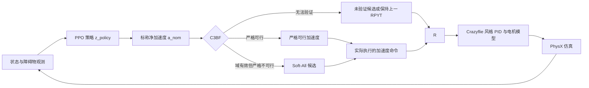

# NavAcc 项目汇报

> **资料状态：** 汇总截至 2026-09-29 已提交的代码、配置和实验记录。文中把当前 C2 capture 基线、C3BF 求解分支和 CBF 奖励 A 的探索实验分开描述；不同训练谱系之间不作单变量因果比较。实验数字均注明评测范围，诊断结果不等同于正式验收。

## 1. 项目目标与 NavAcc 方法概述

NavAcc 的目标是让 Crazyflie 仿真无人机学习在障碍物环境中到达目标点，同时通过 C3BF（第三阶控制障碍函数）修正策略提出的加速度命令，降低碰撞风险。策略直接输出期望的**世界坐标系净加速度**，而不是电机转速；安全过滤器和飞控式控制链负责把策略输出转换成仿真中的飞行器动作。

策略的三维动作是潜变量 `z_policy`，经 `tanh` 和逐轴尺度映射为 `a_nom = [2, 2, 2] ⊙ tanh(z_policy)` m/s²。策略没有独立的 yaw 动作；仿真中 yaw 保持重置时的值。PPO 对数概率仍对应未经安全过滤的策略动作 `z_policy`。仿真物理步长为 2 ms，每个策略步包含 5 个物理子步，因此策略与 C3BF 以 100 Hz 更新，飞控式 PID 与物理仿真以 500 Hz 更新，外层步长为 10 ms。

当前 C2 场景从约 `[-2.5, 0, 1]` 飞向 `[2.5, 0, 1]`，包含两个静态和两个动态圆柱障碍物。抵达条件是与目标的三维距离不超过 0.2 m，连续保持 50 个外层步；单回合最多 1500 个外层步。场景边界为 `x,y ∈ [-3,3]` m、`z ∈ [0.15,3]` m。观察向量采用 `NavAcc-v1-80`：16 维状态和 8 个障碍槽位（每槽 8 个字段）；C2 当前启用 4 个障碍 ID。

**依据与实现：** [NavAcc 接口说明](OmniDrones/docs/control/NAVACC_INTERFACE.md)、[加速度策略与 C3BF 设计](OmniDrones/docs/control/ACCELERATION_RL_C3BF_DESIGN.md)、[NavAcc 环境](OmniDrones/omni_drones/envs/single/nav_acc_sim_pilot.py)、[策略封装](OmniDrones/omni_drones/utils/torchrl/navacc.py)。

## 2. State 与 observation 信息及获取方法

本项目需要区分**仿真内部 state**、**策略 observation**和**供控制器使用的估计状态**。仿真内部保有无人机与障碍物的物理状态；PPO 策略只接收 `agents.observation` 的 80 维向量。C3BF 使用无人机当前仿真状态以及同一障碍物跟踪器输出的位置、速度估计；它不直接使用障碍物真值速度或加速度。`info` 中另存的障碍物真值用于碰撞判定、奖励/统计和离线诊断，不拼入策略 observation。

### 2.1 仿真 state 与来源

| State 信息 | 当前内容 | 获取/用途 |
|---|---|---|
| 无人机本体 | 位置 `p_W`、姿态四元数 `q_WB`、世界系线速度 `v_W`、角速度 | 每个外层决策步从 PhysX/无人机对象 `get_state()` 读取；姿态为 scalar-first `wxyz`。策略输入中的 gyro 是将角速度从世界系转到机体系后的值。当前是仿真状态直读，没有加入 IMU、定位或状态估计误差。 |
| 目标与航向参考 | 目标位置、相对目标向量、重置时记录并保持的 yaw reference | 环境配置目标位置；相对目标量由 `p_goal−p_uav` 计算，yaw reference 在 reset 时从测得姿态捕获。 |
| 障碍物物理真值 | 每个固定 ID 的位置、速度、加速度、active 标记 | 仿真运动模型生成；供碰撞检测、回合统计和离线诊断使用。不会把速度/加速度真值送入障碍物估计器或策略输入。 |
| 障碍物跟踪状态 | 估计位置、估计速度、测量时间戳年龄、valid 标记 | 由定时位置测量经 α-β tracker 更新；供策略槽位和 C3BF 使用。 |
| 控制/回合状态 | yaw hold、外层步计数、上一动作/RPYT、终止与统计量 | 环境及控制器内部保存；仅其中 yaw hold 与剩余时间比例等明确字段进入策略向量。 |

### 2.2 策略的 80 维 observation

observation 类型为 `float32 [B,1,80]`，按下表顺序展平。连续量按配置中的正尺度相除，不额外裁剪；四元数和 sin/cos 保持原值，只有 episode time fraction 裁剪到 `[0,1]`。

| 下标 | 字段 | 维数 | 坐标/单位与编码 | 获取方法及归一化 |
|---:|---|---:|---|---|
| 0–2 | `goal_relative_W` | 3 | 世界系，m | 目标位置减无人机位置，除以 3 m |
| 3–6 | `attitude_quat_WB` | 4 | body→world 四元数，`w,x,y,z` | 从无人机仿真状态读取，不缩放 |
| 7–9 | `velocity_W` | 3 | 世界系，m/s | 仿真状态线速度，除以 3 m/s |
| 10–12 | `gyro_B` | 3 | 机体系，rad/s | 将仿真状态角速度旋转到机体系，除以 10 rad/s |
| 13–14 | `sin(psi_hold_W), cos(psi_hold_W)` | 2 | 世界系 yaw，无量纲 | 对 reset 时捕获并保持的 yaw 取 sin/cos，不直接输入角度 |
| 15 | `episode_time_fraction` | 1 | 无量纲 | `progress / max_episode_length`，裁剪到 `[0,1]` |
| 16–79 | 固定 ID 障碍槽位 | 64 | 8 个槽位，每槽 8 维 | 见下表；C2 当前仅使用 ID 0–3 |

每个障碍槽位的字段顺序为：

| 槽内偏移 | 字段 | 维数 | 含义与归一化 |
|---:|---|---:|---|
| 0–1 | `relative_position_xy` | 2 | `(估计障碍位置−无人机位置)` 的世界系 XY，m，除以 3 m |
| 2–3 | `relative_velocity_xy` | 2 | `(估计障碍速度−无人机速度)` 的世界系 XY，m/s，除以 3 m/s |
| 4 | `radius_xy` | 1 | 障碍物逻辑半径，m，除以 1 m；C2 当前值为 0.3 |
| 5 | `is_dynamic` | 1 | 静态为 0，动态为 1 |
| 6 | `age` | 1 | 有效槽位中最近接受测量的年龄，s，除以 1 s；无效时随整槽归零 |
| 7 | `valid` | 1 | 估计当前有效为 1，否则为 0 |

槽位按固定 object ID 排列，不按离无人机的距离重排。C2 中 ID 0、1 是静态障碍，ID 2、3 是动态障碍，ID 4–7 为预留槽；未使用或无效槽整体填零（`valid=0`），因此策略不能从无效槽的 age 字段区分“尚无测量”和“测量已过期”。所以“80 维”是固定网络接口宽度，并不表示每个时刻有 8 个有效障碍物。障碍物均为 6 m 高的圆柱；当前 observation 和 C3BF 的障碍几何只编码水平面 XY，没有障碍高度/短障碍标志，也不支持从上方或下方穿越障碍。

### 2.3 障碍物位置测量与速度估计

C2 仿真每个 10 ms 外层决策步向测量流提供当前障碍物位置、active 状态和固定 ID。测量流配置为 100 Hz，位置噪声、传输延迟和丢包率均为 0；reset 后启用 reset-epoch anchor，让首个决策时刻获得当前活动障碍的位置。该输入流只接收位置，不接收仿真中的障碍真值速度或加速度。

跟踪器使用常速度 α-β 更新（`alpha=0.85`、`beta=0.1`），由连续位置测量推算水平速度，并按测量时间戳预测到当前决策时刻。当前 `stale_timeout=0.25 s`；年龄超过该阈值时标为无效。跟踪器关闭垂直速度估计。C2 当前零噪声、零延迟、零丢包设置是仿真假设，不代表真实传感器表现。

策略槽位和 C3BF 共用这一估计快照；C3BF 使用估计的障碍位置/速度与无人机当前位置/速度构造约束，障碍加速度则采用零模型估计。仿真真值速度、加速度只用于环境内部的运动、碰撞记录及离线分析。该接口因此是“仿真状态直读 + 理想位置测量 + 速度滤波”的实验设置，尚未接入真实相机、动捕、定位系统或 IMU 观测链。

**依据与实现：** [80 维 observation 接口定义](OmniDrones/docs/control/NAVACC_INTERFACE.md)、[C2 环境与跟踪快照](OmniDrones/omni_drones/envs/single/nav_acc_c2_capture_reward_v1.py)、[基础无人机 observation 构造](OmniDrones/omni_drones/envs/single/nav_acc_sim_pilot.py)、[C2 槽位编码](OmniDrones/omni_drones/envs/single/nav_acc_c2_logic.py)、[位置测量与 α-β 跟踪器](OmniDrones/omni_drones/utils/obstacle_tracking.py)、[C2 继承配置](OmniDrones/cfg/task/NavAccC2CaptureRewardV1.yaml)、[观测尺度和跟踪参数](OmniDrones/cfg/task/NavAccC1SoftAllRewardV3HeightFailOpenPilot.yaml)。

## 3. 动力学模型与建模假设

### 3.1 平移动力学和动作转换

采用 z 轴向上的坐标约定，平移动力学写为：

$m\ddot{p}=T R e_3-mg e_3$ 

期望净加速度 `a_safe` 转成期望推力向量 `f_d = m(a_safe + g e_3)`，其模长给出期望总推力，方向给出机体推力轴 `b_3`。在 yaw 固定的条件下，转换器再计算 roll、pitch、thrust 和 yaw 命令（RPYT），送入 Crazyflie 风格 PID 与电机模型。因而 `a_safe` 是控制目标，不是 PhysX 每帧实际测得的加速度；姿态限制、电机时间常数和闭环动态都会造成跟踪误差或滞后。

### 3.2 仿真参数与建模假设

| 项目 | 当前配置/假设 | 说明 |
|---|---|---|
| 质量 | 0.042 kg | Crazyflie 仿真资产参数 |
| 转动惯量 | 对角阵 `[3.3e-5, 3.6e-5, 5.9e-5] kg·m²` | 仿真资产参数 |
| 电机时间常数 | 0.05 s | 一阶电机响应参数 |
| 最大倾角 | 35° | 加速度到 RPYT 转换器限制 |
| 命令净加速度尺度 | 每轴 2 m/s² | 策略输出缩放；C3BF 的 XY 圆盘半径也设为 2 m/s²，z 命令界为 ±2 m/s² |
| 障碍物半径 / 无人机 XY 半径 | 0.3 m / 0.1 m | C2 障碍与机体近似为圆柱/圆盘 |
| 障碍物运动上限 | 速度 0.5 m/s，标称加速度 1.0 m/s² | 场景配置上限；求解器当前使用的障碍加速度估计为 0 |
| 估计误差 | 仿真估计噪声、延迟、丢包均为 0 | 属于理想观测设置 |

上表的命令边界是算法的输入/输出约束，不代表飞行器经过实测认证的加速度能力。当前 `acceleration_to_rpyt.py` 的电机推力曲线校准标记为 `UNVALIDATED`，所以这些结果只支持当前仿真链路下的结论，不能作为真实 Crazyflie 的飞行性能验证。

**依据与实现：** [Crazyflie USD 参数](OmniDrones/omni_drones/robots/assets/usd/crazyflie.yaml)、[加速度到 RPYT 转换](OmniDrones/omni_drones/controllers/acceleration_to_rpyt.py)、[仿真 pilot](OmniDrones/omni_drones/controllers/navacc_sim_pilot.py)、[C2 capture 配置](OmniDrones/omni_drones/cfg/task/NavAccC2CaptureRewardV1.yaml)。

## 4. C3BF 设计、约束和求解方法

### 4.1 障碍物约束

对每个有效障碍物，在水平面定义相对位置和速度：`p = p_obs − p_uav`、`w = v_obs − v_uav`。膨胀后的安全半径为

$$
R=r_{obs}+r_{uav}+d_{safe}=0.3+0.1+0.1=0.5\text{ m}, $$

即在 0.4 m 几何接触包络外增加 0.1 m 安全裕量。定义 `ρ = sqrt(||p||² − R²)`、`s = ||w||`、`h = p·w + ρs`、`q = p + (ρ/s)w`。在定义域有效时，条件 `h_dot + γh ≥ 0` 可写成针对无人机水平加速度的半平面约束：
$$
q_i\cdot a_{uav,xy}\le b_i,
$$

$$ b_i=s^2+\frac{s}{\rho}(p\cdot w)+q_i\cdot\hat a_{obs}+\gamma h-\|q_i\|(\epsilon_{obs}+\epsilon_{track}).
$$

当前名义配置取 `γ=1/s`、障碍加速度估计 `â_obs=0`、`ε_obs=ε_track=0`。各障碍物约束只作用于 XY；C3BF 本身不处理场地边界和垂直避障。求解输出受 `||a_xy||≤2 m/s²`、`−2≤a_z≤2 m/s²` 限制。

### 4.2 严格求解与 Soft-All

严格求解先检查观测有限且新鲜、`ρ²>1e-4`、相对速度超过阈值以及 `q` 等中间量有效，再求离标称动作最近的可行加速度。代码最多做 10 轮“最大归一化违反量投影 + 物理边界投影”；当前任务配置 `analytic_candidates_v1` 在贪心迭代失败时会枚举有限的几何候选，并用原始全部约束和动作边界复核候选。贪心路径若提前找到可行动作，不保证该动作是全局最近点。可行性证书及其一般候选覆盖能力仍有审计未决项，不能据此声称所有情况都能完备判定。

Soft-All 只在标称动作和约束定义域有效、但严格约束组不可行时尝试。其目标为

$$
\min_{a,\delta}\|a-a_{nom}\|^2+\lambda\sum_i\delta_i^2,
\quad \delta_i=\max(0,q_i\cdot a_{xy}-b_i),
$$

并保留 XY 加速度圆盘和 z 轴硬边界。当前 `λ=1 m⁻²`。实现枚举最多 8 个约束的 hinge 活跃区域，配合有界圆盘 KKT 二分求解，以 float64 计算后再校验输出类型。严格可行时原样执行严格解、slack 为零；Soft-All 允许 CBF 行有正 slack，因此属于软化的折中动作，不是严格安全证明。定义域无效时，Soft-All 也不适用。

### 4.3 无法验证时的运行时处理

当前 C2 capture 配置设为 `unverified_candidate_continue_v1` 且 `terminate_on_failure=false`。严格解和 Soft-All 都未产出有效动作时，运行时代码会检查原求解器候选是否有限并满足物理动作边界；若通过，就将其作为 `UNVERIFIED_CANDIDATE` 转为 RPYT 执行。该候选没有通过 C3BF 行约束验证。如果不可用，则保持上一 RPYT。此处理能让回合继续，但不能称为安全过滤或 CBF 约束满足。

**依据与实现：** [C3BF 设计和求解审计](OmniDrones/docs/cbf/NAVACC_C1_C3BF_DESIGN_SOLVER_AUDIT.md)、[Soft-All 说明](OmniDrones/docs/control/NAVACC_C3BF_SOFT_ALL_V1.md)、[严格求解诊断实现](OmniDrones/omni_drones/utils/navacc_acceleration_c3bf_diagnostic.py)、[Soft-All 实现](OmniDrones/omni_drones/utils/navacc_c3bf_soft_all_v1.py)、[当前 C2 reward 配置](OmniDrones/omni_drones/cfg/task/NavAccC2CaptureRewardV1.yaml)。

## 5. 求解问题、原因分析与解决办法

| 现象 | 原因分析 | 已采用的处理 | 当前结论/剩余问题 |
|---|---|---|---|
| 低相对速度时 C3BF 行无法计算 | `s=||w||` 出现在分母；相对速度为零时 `w/s` 未定义。初期严格分支阈值为 0.05 m/s，导致部分帧被归为低速定义域失败。 | 当前任务分支把阈值降到 `1e-4 m/s`，减少接近低速但非零时的拒绝。 | 只是移动阈值；`s=0` 的数学奇点仍在，不能靠阈值修复。严格训练审计中，761 个 CBF 终止回合有 341 个归为相对速度 ≤0.05 m/s。 |
| 多障碍严格约束无共同可行解 | 若多个半平面与 XY 加速度圆盘不相交，严格安全动作不存在；这是真实不可行，不是单纯数值精度问题。 | 增加 `analytic_candidates_v1` 几何候选搜索；域有效时再用 Soft-All 允许正 slack。 | 旧严格审计中有 392 个 `INFEASIBLE_PROVEN` 记录（单行 96、双行 45、三行 251）。Soft-All 降低求解器直接失败的概率，但让出了严格约束。 |
| UAV 进入膨胀半径后约束域失效 | `ρ²=||p||²−R²<0`，`ρ` 为实数的定义不成立。当前障碍膨胀半径 R=0.5 m；该情形可发生在接触前的 0.4–0.5 m 区间。 | 运行时使用未验证候选继续，避免回合立即停止；诊断记录逐障碍物有效性与原因码。 | 2026-09-29 域审计中，碰撞窗口覆盖率仅 MODE 76.36%、RANDOM 71.31%；28 个 MODE、29 个 RANDOM 碰撞回合均至少有一次真实碰撞障碍行失效。降低速度阈值、调 epsilon 或 Soft-All 都不能修复 `ρ²<0`。需要另一种适用于该区域的屏障或备份控制策略；`h_sigma` 仍是候选研究方向，尚未集成。 |
| 动作继续执行但无法确认安全 | fail-open 分支只检查数值和物理动作边界；`UNVERIFIED_CANDIDATE` 未通过障碍物 CBF 行。 | 明确标记输出来源，记录严格、Soft-All、未验证候选等路径计数。 | 这是回合连续性策略，不是安全保证。需在策略训练和评估中单独统计，不能把“未终止”视为过滤成功。 |
| 候选 A 的 CBF reward 在关键时段取不到有效量 | 奖励依赖有效的 `q_i,b_i`；域无效时无法计算真实违反量。代码使用数值 0 作为占位，但 0 不代表零违反。 | 采用碰撞前窗口覆盖率门槛做训练资格审查。 | A 的覆盖率未达 90% 门槛，`w_star=null`、`training_ready=false`；目前不能据此确定 reward 系数或宣称该奖励安全有效。 |

严格求解阶段的一次固定 1024 回合审计结果为：761 个 CBF 终止、262 个越界、1 个碰撞、0 个抵达。该结果揭示的失败包括低速定义域、真实不可行以及接近/进入 `ρ` 边界等几类，不能统称为“QP 数值不稳定”。后续通过放宽低速阈值、几何候选和 Soft-All 改善了运行时可用性，但没有消除 barrier 的数学定义域问题。

**依据与记录：** [严格求解审计](OmniDrones/docs/cbf/NAVACC_C1_C3BF_DESIGN_SOLVER_AUDIT.md)、[C1 CBF 训练问题记录](OmniDrones/docs/cbf/NAVACC_C1_CBF_RL_TRAINING_ISSUES.md)、[C2 CBF 域覆盖审计](../experiment_artifacts/navacc_c2_rcbf_domain_audit_20260929_v1/analysis_memo.md)。

## 6. reward 形式、参数及设置依据

当前 C2 capture 基线继承 C1 Soft-All reward 与 capture-hold reward。奖励按每个环境、每个外层策略步计算，不乘 `dt`。主要密集项如下：

| 项目 | 形式/参数 | 作用与依据 |
|---|---|---|
| 距离进展 | `1.5 × clamp((d_pre−d_post)/(1.8×0.01), −1, 1)` | 鼓励每步靠近目标；按外层步长 0.01 s 与 1.8 m/s 归一化并截断。 |
| 捕获势能差 | `6 × (φ(d_post)−φ(d_pre))`，`φ(d)=clamp((0.5−d)/0.3,0,1)` | 在接近目标的 0.2–0.5 m 区域提供捕获进展信号；成功半径为 0.2 m。 |
| 制动惩罚 | `−2 × clamp((v_in−v_allow)/1.8,0,1)²` | 惩罚以过高速度接近；`v_allow=clamp(√((a_ref·0.01)²+2a_ref·max(d_post−0.2,0))−a_ref·0.01,0,1.8)`，`a_ref=0.7310784 m/s²`。该值由 probe 得到，仅作为 reward 塑形参考，不是认证的制动能力。 |
| 边界风险 | `−2 × max_face(risk_face²)` | 对六个 arena 边界面计算停止距离风险；buffer=0.2 m、risk scale=0.5 m。停止距离用 `v_out·0.01+v_out²/(2a_ref)` 估算。 |
| 高度/地面风险 | `−4 × risk_floor²` | 根据向下速度和同一 `a_ref` 估算至 crash floor `z=0.15 m` 的制动风险；buffer=0.2 m、scale=0.5 m。 |
| 到达驻留 | 目标距离 ≤0.2 m 时每步 `+0.2` | 鼓励满足连续 50 步驻留条件，而非只掠过目标。 |
| 标称动作平滑 | `−0.2 × Σ(((a_nom,t−a_nom,t−1)/2)²)` | 减少标称加速度突变；作用于安全过滤前的策略动作。 |

稀疏事件项包括：首次碰撞 `−2`、crash `−15`、越界 `−15`、超时 `−60`；成功到达奖励为 `40 + 40×(1−step/1500)`。配置中的 `terminal_penalty=-20` 在当前 reward 实现中没有被使用；CBF 求解失败也没有单独的即时负奖励。以上参数是当前实验配置，不代表已通过网格搜索或真实飞行校准。

较早的 Soft-All V1 曾奖励在 0.2–0.5 m 区域的停留，即使速度为零也可持续获得正奖励；代码审查识别到它可能与真正抵达目标的目标冲突。V2 以距离进展、制动、边界和驻留项替换该区域占用项。这是针对奖励结构的修订，不足以单独证明训练行为变化由某一个奖励项导致。

另有一个**探索性** CBF 违反奖励 A：`V=max_i clamp(relu(q_i·a_nom,xy−b_i−1e−6)/(||q_i||·2),0,1)`，`r_cbf=−0.1V`。它根据过滤前的标称动作与有效 CBF 行计算；不是 Soft-All slack 或过滤修正量。障碍行无效时违反量不可知，日志中的零是占位值。覆盖审计未过门槛，因此 `w=0.1` 只是试验候选，不是已选定的正式参数。

**依据与实现：** [C2 reward 配置](OmniDrones/omni_drones/cfg/task/NavAccC2CaptureRewardV1.yaml)、[C1 capture reward 配置](OmniDrones/omni_drones/cfg/task/NavAccC1CaptureRewardV1.yaml)、[Soft-All V2 reward 实现](OmniDrones/omni_drones/utils/torchrl/navacc_c1_soft_all_v2_reward.py)、[高度风险 reward 实现](OmniDrones/omni_drones/utils/torchrl/navacc_c1_height_reward_v3.py)、[capture-hold reward 实现](OmniDrones/omni_drones/utils/torchrl/navacc_c1_capture_hold_reward.py)、[A 奖励探索记录](../experiment_artifacts/navacc_c2_rcbf_A_exploratory_20260929_v1/analysis/report_zh.md)。

## 7. 实验表现、局限与后续工作

### 7.1 已有结果

| 实验 | 评测与结果 | 解读 |
|---|---|---|
| C1 Soft-All V1 | 最终固定 1024 回合：到达 0、碰撞 0、越界 737、CBF 失败 275、crash 11、超时 1。 | 没有达到导航目标；零碰撞不能脱离大量越界和 CBF 失败单独解释。 |
| C2 capture 连续 6M，seed 6424 | 一次连续训练 6,094,848 新帧、186 次更新、1024 个并行环境。6M checkpoint 的固定 ID 0–255 诊断：到达 176/256（68.75%）、碰撞 26（10.16%）、crash 3、越界 13、超时 38。 | 这是当前已报告的较好 C2 checkpoint 诊断，但 6M 评测是固定 ID 诊断，不是正式 EVAL256，更不是固定 1024 回合验收；未达项目筛选目标 85% 到达、5% 碰撞。不能据此主张 CBF 已提供严格安全保证。 |
| CBF reward A 探索 | 2,031,616 新帧、62 次更新；固定 ID 诊断到达 36/256（14.06%）、碰撞 25（9.77%）、超时 43、越界 152、crash 0。 | 这是探索分支诊断，不是正式验收。其初始化只加载父模型的 actor/action distribution 参数，critic、ValueNorm 与 optimizer 重置；与 C2 基线不是只改 reward 的对照，不能把表现差异归因于 `w=0.1`。训练资格域审计未通过。 |

C2 连续训练中 strict 有效解约 5,977,496 帧（98.07%）、Soft-All 88,298 帧（1.45%）、未验证候选 29,054 帧（0.477%）。这些是训练帧路径统计，不是安全率或评测结论。碰撞窗口内 barrier 行可用性不足，尤其不能用全训练时段 99% 左右的覆盖率替代碰撞前覆盖率。

**实验记录：** [C1 Soft-All 固定 1024 报告](../experiment_artifacts/navacc_c1_c3bf_soft_all_1500_20260927_v1/final_report.md)、[C2 seed6424 连续 6M 报告](../experiment_artifacts/navacc_c2_continuous_6m_seed6424_20260929_v2/reports/final_report.md)、[CBF reward A 探索报告](../experiment_artifacts/navacc_c2_rcbf_A_exploratory_20260929_v1/analysis/report_zh.md)、[A 奖励域审计](../experiment_artifacts/navacc_c2_rcbf_domain_audit_20260929_v1/analysis_memo.md)。

### 7.2 局限与后续工作

1. **先处理 C3BF 定义域。** 针对 `s→0` 与 `ρ²≤0` 设计可定义、可验证的屏障或备份控制；明确有效域之外的策略和终止语义。对碰撞前窗口逐障碍物审计覆盖率，避免以全局平均值掩盖关键时段缺口。
2. **区分严格安全与可运行性。** 分别报告严格 C3BF 可行、Soft-All（含 slack）、未验证候选、保持上一命令的占比和结果；评估时避免把 fail-open 继续运行计作过滤成功。
3. **提升求解器完备性与可验证性。** 对候选枚举、可行性判断、证书构造和数值容差补齐独立审计；验证退化行、近零速度、多障碍组合以及动作圆盘边界情况。现有审计不支持对一般情况作完备性承诺。
4. **建立可比较的训练评测。** 固定初始化权重、数据协议、种子和正式 EVAL256/1024 流程，再做单变量 reward 对照和多 seed 评估。当前 C2 6M 与 reward A 结果不能直接作因果比较。
5. **校准动力学后再谈实机迁移。** 评估推力曲线、最大倾角、电机响应和加速度跟踪误差，重新标定 `a_ref`、`epsilon` 与动作边界；当前模拟参数和零噪声估计假设都不足以支持真实飞行安全结论。
6. **继续检查 reward 与终止条件的一致性。** 验证制动/边界/高度项对到达率和越界率的影响，确认配置中未被使用的 `terminal_penalty` 是否应删除或实现，并对捕获驻留条件做消融。

**汇报结论：** NavAcc 已形成从策略加速度、C3BF 过滤到飞控式仿真的端到端训练链路，并有可复现的 C2 训练与求解诊断记录。当前最主要的技术瓶颈是 C3BF 的定义域覆盖和不可行状态处理；当前最好的 C2 结果仍未通过项目筛选目标，CBF reward A 也尚未具备训练资格。下一阶段应优先修复有效域与评测对照，再讨论安全收益及实机迁移。
